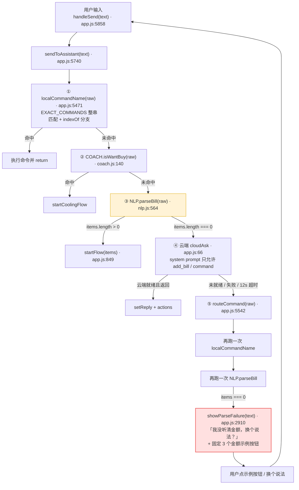
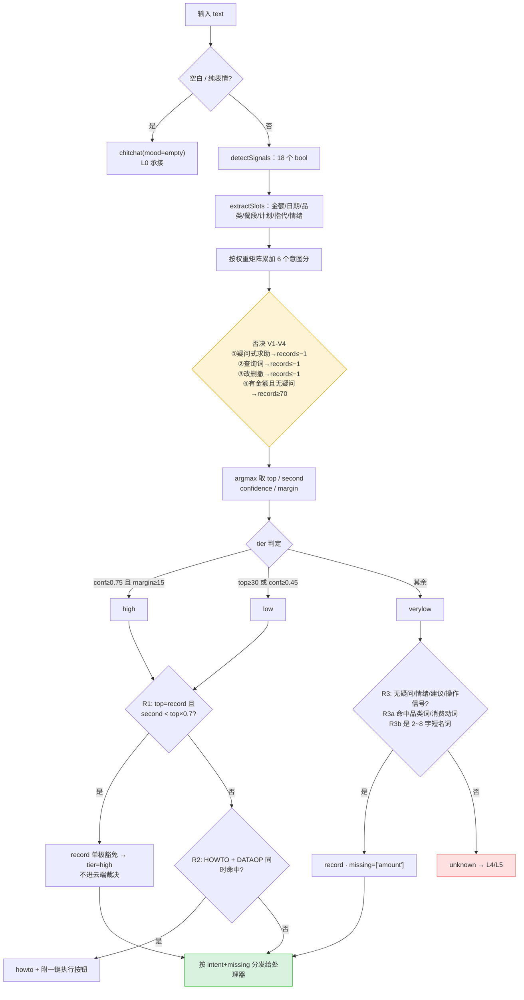
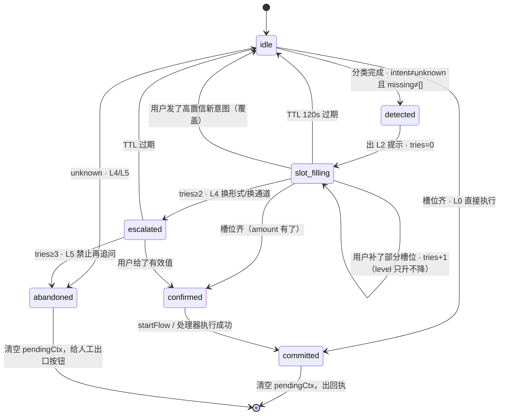
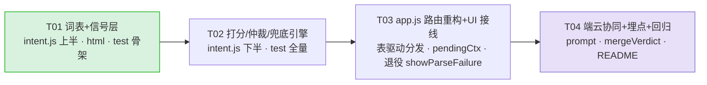

# 意图路由与模糊兜底设计方案

> 版本 v1.0 · 面向「AI 校园记账管家」（`D:/AI 智能体创新应用大赛作品/AI记账`）
> 目标：**在识别不出明确金额时也能合理回应，而非反复要求用户重说。**
> 定位：设计文档，本次不改业务代码。所有行号基于当前仓库（`app.js` 6499 行 / `nlp.js` 653 行）。

---

## 0. 一句话结论

现在的问题不是「NLP 认不出金额」，而是**整条链路只有一个语义判断维度（有没有金额）和两个出口（记账 / 没听清金额）**。
本方案在 `sendToAssistant` 之前插一层 **本地规则打分意图分类器 `intent.js`**（<1ms、纯函数、可 Node 单测），把「一句话」先落到 7 个意图之一，再按**槽位缺失情况**走 6 级模糊兜底阶梯，并用 **pending 状态机 + 反死循环硬规则**保证同一句提示语绝不重复出现。

---

## 1. 现状诊断

### 1.1 死循环链路图



### 1.2 根因（5 条，逐条对应可改的位置）

| # | 根因 | 证据（代码位置） | 后果 |
|---|---|---|---|
| **A** | **默认所有输入 = 记账** | `sendToAssistant` 全程没有"这句话想干什么"的判断；第 ③ 步 `parseBill` 是唯一的语义入口 | 疑问句、计划、闲聊全部被当成"记错了的一句话" |
| **B** | **成败二值，没有分级** | `parseBill` 只返回 `{items, unparsed}`，成败判据只有 `items.length === 0`（nlp.js:622） | 无法表达"意图对但缺金额""一句多笔只解出一笔""金额是十几块这种模糊量" |
| **C** | **失败响应无状态、无记忆** | `showParseFailure(text)`（app.js:2910）是纯函数：不看历史、不看 `tries`、不看用户上一句说了什么 | 第 2 次、第 3 次失败输出**逐字相同**，用户被推回同一个死胡同 → 死循环感 |
| **D** | **没有槽位概念，没有补全机制** | 记账天然需要「金额 + 品类 + 时间」，代码里只有 `parseBill` 内部的隐式推断，没有"缺哪个就只问哪个"的机制 | 缺金额时无法只问金额，只能整句否定"我没听清金额" |
| **E** | **端云职责重叠且动作集一样窄** | 云端 system prompt（app.js:72-79）的 `actions` 只有 `add_bill` 和 `command`，**没有 clarify / intent 字段** | 云端同样只会"记账或说话"；云端失败后又降级回 ⑤ 的同一条本地路径，等于没有第二个大脑 |

**补充 F（放大器）**：命令白名单是 `EXACT_COMMANDS` 整串相等（app.js:5440-5465）+ 一串 `indexOf` 关键词分支，**任何自由文本都必然掉到链路最末端的 `showParseFailure`** —— 那是唯一出口，而它的文案只有一个。

### 1.3 两个实测案例的机制解释

| 用户输入 | 链路走向 | 为什么必然失败 |
|---|---|---|
| `忘记记昨天的怎么办` | ①不命中 → ②非想买 → ③`findAmounts` 找不到数字（"昨天"无数字，"怎么办"无数字）→ items=[] → ④云端（断网则直接跳过）→ ⑤ → `showParseFailure` | 句中**「怎么办」是强疑问信号、「昨天」是时间信号**，两个都是"意图线索"，但代码里没有任何一处在看它们 |
| `明天约女朋友吃晚饭` | 同上，逐字相同 | 句中有**品类词（晚饭）+ 社交词（女朋友）+ 计划语气（明天/约）**，是最典型的"记账缺金额+未来计划"，却被当成"说错了" |

**关键观察**：两次失败回复的**文本 + 按钮 100% 相同**（app.js:2911-2917 是硬编码字符串）。这是"死循环感"的直接来源。

### 1.4 README 自述印证

`README.md:679`：「NLP 不是大模型……生僻说法会走到「没听清金额」的兜底」——
本方案正是把这个"兜底"从**单点否定**改造成**分级承接**。而生僻说法（如「红糖糍粑」）在分类器眼里应该是 **`record` 缺金额**，问「多少钱？」，而不是「我没听清金额」。

---

## 2. 意图体系与判定规则

### 2.1 意图枚举（`command` + 7 个意图 + 2 组子槽位）

> **`command` 是第 8 种，但它不在 `intent.js` 里判定** —— 明确命令由 `app.js` 改造后的 `commandMatch()` 在分类之前短路（保持现有"命令优先、且带金额不当命令"的规则）。`intent.js` 的 `INTENTS` 常量只有 7 个：`record / query / howto / advice / dataop / chitchat / unknown`。
>
> 设计取舍：`query` 不拆成 4 个顶层意图，而是用 `slots.queryKind` 区分。理由：余额 / 饼图 / 统计 / 明细共享同一批"查询证据"（疑问词、指代、统计动词），拆开会互相抢分；用子槽位只需在**处理器分发表**里多 4 个 key。

| # | intent | 中文名 | 触发词 / 句式特征 | 必需槽位 | 命中后的处理器（现有函数 / 新增） |
|---|---|---|---|---|---|
| 1 | `command` | 明确命令 | 与 `EXACT_COMMANDS` 或命令关键词分支命中 | — | `commandMatch()` 返回的 `fn`（**在 intent.js 之外判定**，见 4.2） |
| 2 | `record` | 记账 | 有金额；或有消费动词 / 品类词且无疑问结构 | `amount`（必需）<br>`date`/`category`/`meal`（可推断） | `startFlow(NLP.parseBill(raw).items)`（现有 app.js:849） |
| 2a | `record` + `plan=true` | 记账·未来计划 | `明天/约/打算/准备/周末` + 品类 | 同上 | 先承接一句「还没发生吧」，再走 2/2b |
| 2b | `record` 缺 `amount` | 记账·缺金额 | 品类词 / 消费动词 / 计划语气，但 `findAmounts` 为空 | `amount` | **新增** `fuzzyAskAmount()`（L2 阶梯） |
| 3 | `query` | 查询 | 疑问词 + 统计动词 / 余额词 / 饼图词 / 指代 | `queryKind` | `balance→showBalanceCard`<br>`pie→showPieCard`<br>`category→`**新增** `answerCategoryQuery()`<br>`detail→`**新增** `answerDetailQuery()` |
| 4 | `howto` | 咨询求助 | `怎么办/咋办/怎么弄/如何/能不能/教我/在哪` | `topic`（补记/改/删/在哪） | **新增** `answerHowto(topic)`，出口按钮直接调 `openQuickAddModal` / `undoLast` / `showEntryGuide` |
| 5 | `advice` | 理财建议 | `想买/该不该/值不值/要不要/怎么省/省钱/剁手/忍不住` | `adviceKind`（wantbuy/save/earn） | `wantbuy→startCoolingFlow`（现有）<br>`save→showSaveMoneyGuide`（现有）<br>`earn→showMakeMoneyGuide`（现有） |
| 6 | `dataop` | 数据操作 | `改/删/撤销/撤回/取消/记错/不是这个` | `target`（last / 指定笔） | `undoLast()`（现有 app.js:822）/ **新增** `answerFixLast()` |
| 7 | `chitchat` | 闲聊情绪 | 情绪词、纯表情、极短无信息量 | — | **新增** `answerChitchat(mood)`：承接 + 3 个出口按钮 |
| 8 | `unknown` | 无法判定 | 打分不过阈值且无兜底证据 | — | **新增** `answerGiveUp()`（L5，`showParseFailure` 降级后的唯一用处） |

### 2.2 判定信号表（18 个信号，可直接实现）

信号检测**全部复用现有词典与函数**：`DATA.CATEGORY_KEYWORDS`、`DATA.DATE_WORDS`、`DATA.MEAL_WORDS`、`DATA.EMOTION_KEYWORDS`、`NLP.findAmounts()`、`NLP.classify()`、`NLP.normalizeWidth()`。

| ID | 信号名 | 判据（正则 / 调用） | 抽取槽位 |
|---|---|---|---|
| `SIG_EMPTY` | 空 / 纯表情 | `len<=1` 或 去除 emoji+标点后为空 | — |
| `SIG_AMOUNT` | 精确金额 | `NLP.findAmounts(t).length > 0` | `slots.amount`（取第一笔） |
| `SIG_AMOUNT_FUZZY` | 模糊金额 | 无精确金额 且 `/十几\|几十\|百来\|小一百\|差不多\d\|大概\d\|\d左右\|不到\d\|半百\|一杯\|一顿/` | `slots.amountFuzzy` |
| `SIG_SPEND_VERB` | 已发生消费动词 | `/买了\|花了\|付了\|充了\|交了\|吃了\|喝了\|下单了\|打车\|转账\|请客/`（**刻意不含裸"吃/喝/买"**，否则与计划语气冲突） | — |
| `SIG_PLAN_VERB` | 计划语气 | `/想买\|要买\|要去\|打算\|准备\|计划\|约\|明天\|后天\|下周\|周末\|一会\|待会/` | `slots.plan=true` |
| `SIG_TIME_PAST` | 过去时间词 | `DATA.DATE_WORDS` 中 `offset <= 0` 命中 | `slots.date` |
| `SIG_CATEGORY` | 品类 / 餐段词 | `NLP.classify(t) !== '其他'` 或 `MEAL_WORDS` 命中 | `slots.category` / `slots.meal` |
| `SIG_HOWTO` | 怎么办式求助 | `/怎么办\|咋办\|怎么弄\|怎么搞\|如何\|怎么补\|怎么改\|怎么删\|教我\|能不能补\|忘记记/` | `slots.topic` |
| `SIG_YESNO` | 是否式疑问 | `/吗\|么$\|能不能\|可不可以\|是不是\|行不行\|有没有\|贵吗\|划算吗/` | — |
| `SIG_WH` | 疑问词 | `/多少\|几\|哪\|啥\|什么\|为什么\|咋/`（**刻意不含"怎么"**，归 `SIG_HOWTO`，避免双重计数） | — |
| `SIG_QMARK` | 问号 | `/[?？]/` | — |
| `SIG_Q_BALANCE` | 余额查询 | `/余额\|还剩\|还能花\|剩多少\|够花/` | `queryKind=balance` |
| `SIG_Q_PIE` | 结构查询 | `/饼图\|占比\|结构\|大头\|花在哪些\|分布/` | `queryKind=pie` |
| `SIG_Q_STAT` | 统计查询 | `/花了多少\|一共花\|总共花\|统计\|汇总\|查一下\|看看\|这周花\|本月花\|上个月花\|这个月.*多少/` | `queryKind=category\|detail` |
| `SIG_ANAPHORA` | 指代 | `/那笔\|这笔\|哪笔\|它\|刚才那\|上一条\|上一笔/` | `slots.target='last'` |
| `SIG_DATAOP` | 改 / 删 / 撤 | `/改一下\|修改\|改掉\|删掉\|删除\|撤销\|撤回\|取消\|记错\|不是这个\|不对/` | `slots.target` |
| `SIG_EMOTION` | 情绪 | `DATA.EMOTION_KEYWORDS` ∪ 新增 `MOOD_WORDS`（累/烦/emo/难受/焦虑/穷/吃土/压力/崩溃/无语/开心/爽） | `slots.mood` |
| `SIG_ADVICE` | 求建议 | `/想买\|该不该\|值不值\|要不要\|值得吗\|怎么省\|省钱\|剁手\|忍不住\|冲动/` | `adviceKind` |

### 2.3 权重矩阵（信号 × 意图，正整数加分 / 负整数否决）

> 单位：分。全部写死在 `intent.js` 的 `WEIGHTS` 常量里，**可被单测逐格断言**。

| 信号 | record | query | howto | advice | dataop | chitchat |
|---|---:|---:|---:|---:|---:|---:|
| `SIG_AMOUNT` | **+62** | 0 | 0 | +6 | −10 | −15 |
| `SIG_AMOUNT_FUZZY` | +26 | +4 | +2 | +4 | −8 | 0 |
| `SIG_SPEND_VERB` | **+30** | 0 | 0 | 0 | +6 | −6 |
| `SIG_PLAN_VERB` | +16 | +2 | +2 | +12 | 0 | +4 |
| `SIG_TIME_PAST` | +10 | +8 | +6 | 0 | +6 | 0 |
| `SIG_CATEGORY` | +18 | +10 | 0 | +2 | 0 | 0 |
| `SIG_HOWTO` | **−55** | +10 | **+58** | +8 | +6 | 0 |
| `SIG_YESNO` | −28 | +12 | +20 | +6 | 0 | 0 |
| `SIG_WH` | −22 | **+26** | +16 | +6 | 0 | 0 |
| `SIG_QMARK` | −12 | +8 | +10 | +4 | 0 | 0 |
| `SIG_Q_BALANCE` | −25 | **+64** | 0 | 0 | 0 | 0 |
| `SIG_Q_PIE` | −25 | **+60** | 0 | 0 | 0 | 0 |
| `SIG_Q_STAT` | −18 | **+44** | 0 | 0 | 0 | 0 |
| `SIG_ANAPHORA` | −10 | +14 | +4 | 0 | +12 | 0 |
| `SIG_DATAOP` | −34 | +6 | +8 | 0 | **+60** | 0 |
| `SIG_EMOTION` | −12 | 0 | 0 | +4 | 0 | **+42** |
| `SIG_ADVICE` | −12 | 0 | +4 | **+46** | 0 | +4 |
| `SIG_EMPTY` | −60 | −60 | −60 | −60 | −60 | **+50** |

### 2.4 仲裁规则（阈值 / margin / 硬规则）

#### 常量

```js
var SCORE_LOW       = 30;    // 低于此分且无兜底证据 -> unknown
var SCORE_HIGH      = 55;    // 高置信线
var MARGIN_MIN      = 15;    // 冠军与亚军的最小分差
var CONF_HIGH       = 0.75;
var CONF_LOW        = 0.45;
var RECORD_DOMINANCE = 0.70; // record 单极豁免：亚军 < 冠军 * 0.7 时不再犹豫
var FORCE_RECORD_MIN = 70;   // 「带金额 + 无疑问」强制 record 的下限
```

#### confidence 归一化（可解释、无魔法）

```js
function toConfidence(top, second) {
  var v = ((top - Math.max(0, second)) + 40) / 100;   // 分差 +40 基线，越大越自信
  return Math.max(0, Math.min(0.99, v));
}
```

#### 4 条否决规则（Veto，先于 argmax 生效）

| ID | 条件 | 动作 | 保护的业务规则 |
|---|---|---|---|
| **V1** | `SIG_HOWTO` 且 **无** `SIG_AMOUNT` | `record = min(record, −1)` | 疑问式求助永远不当成记账（修 `忘记记昨天的怎么办`） |
| **V2** | (`SIG_Q_BALANCE` \| `SIG_Q_PIE` \| `SIG_Q_STAT`) 且 **无** `SIG_AMOUNT` | `record = min(record, −1)` | 查询句不当记账 |
| **V3** | `SIG_DATAOP` 且 **无** `SIG_AMOUNT` 且 **无** `SIG_HOWTO` | `record = min(record, −1)` | 改删撤不当记账 |
| **V4** | `SIG_AMOUNT` 且 无 (`SIG_HOWTO` \| `SIG_YESNO` \| `SIG_WH` \| `SIG_QMARK` \| `SIG_Q_BALANCE`) | `record = max(record, 70)` | **保留现有规则「句子里带金额的一律当成记账」**（app.js:5489-5493 注释处）——`肯德基疯狂星期四 25` 必须记账，不能被活动卡抢走 |

> **V4 是唯一一条"抬分"规则，它的存在就是为了不破坏现有业务。** 注意：`commandMatch()`（改造前的 `localCommandName`）仍在意图分类**之前**执行，所以「设置预算 1000」这类命令不会进 V4。

#### 兜底规则（Veto 之后、argmax 之后执行）

| ID | 条件 | 动作 | 解决的问题 |
|---|---|---|---|
| **R1 record 单极豁免** | `top === 'record'` 且 `second.score < top.score * 0.7` | `tier = 'high'`（跳过云端裁决，直接走 record 阶梯） | `明天约女朋友吃晚饭`（34 vs 14）不必等云端 3 秒，本地立刻"缺金额"承接 |
| **R2 疑问覆盖改删** | `SIG_HOWTO` 且 `SIG_DATAOP` | `intent = 'howto'`，并在回复里**附一键执行按钮** | 「记错了怎么删掉」是在问方法，不是命令；但仍要给它"帮我删"的出口 |
| **R3 品类兜底**（分两级） | | | |
| **R3a** | `top.score < SCORE_LOW` 且 无任何疑问/情绪/建议/操作信号 且 (`SIG_CATEGORY` \| `SIG_SPEND_VERB`) | `intent='record'`, `tier='low'`, `missing=['amount']` | `奶茶` / `三食堂` / `一双鞋` → 问「多少钱？」而不是「我没听清金额」 |
| **R3b 短名词兜底** | `top.score < SCORE_LOW` 且 无任何疑问/情绪/建议/操作/问候信号 且 去空白后 `2 ≤ len ≤ 8` 且 不含数字 | `intent='record'`, `tier='verylow'`, `missing=['amount']`, `slots.category='其他'` | `红糖糍粑`（`NLP.classify` 返回「其他」）→ 仍问「多少钱？」，这是 README:679 那个痛点的正解 |
| **R3-守卫 问候短路** | `LEX.GREETING` 命中（你好/在吗/谢谢/好的/晚安…）或 `len ≤ 1` | `intent='chitchat'`, `tier='high'` | 防止 R3b 把 `你好` 判成「你好多少钱？」 |

> **R3b 的存在理由**：记账 App 里"短、无动词、无问号、无数字"的名词，绝大多数是商品名/档口名。
> 问一句「多少钱？」的成本远低于"我没听清金额"，而后者会让用户以为系统坏了。
> `tier='verylow'` 只是标记置信度，**不触发云端裁决**（见 §4.2.1 的 `needsCloudVerdict`），本地立刻出 L2。

#### 7 个关键案例的算例（可直接写成单测断言）

**① `忘记记昨天的怎么办`**

```
命中信号：SIG_HOWTO(怎么办) · SIG_TIME_PAST(昨天)
record  = −55 + 10            = −45
query   = +10 + 8             =  18   ← second
howto   = +58 + 6             =  64   ← top
advice  = +8                  =   8
V1 生效：record = min(−45, −1) = −45（已远低于 0，否决规则在此只是兜底）
confidence = ((64 − 18) + 40)/100 = 0.86   margin = 46
tier = high  →  intent = howto         ✅ 不是 record
```

**② `明天约女朋友吃晚饭`**

```
命中信号：SIG_PLAN_VERB(明天/约) · SIG_CATEGORY(晚饭→餐饮, 女朋友→社交；NLP.classify 最终取「社交」)
record  = +16 + 18            =  34   ← top
query   = +2  + 10            =  12
advice  = +12 + 2             =  14   ← second
howto   = +2                  =   2
confidence = ((34 − 14) + 40)/100 = 0.60
second(14) < 34 × 0.7 = 23.8  →  R1 单极豁免
intent = record · plan = true · missing = ['amount']   ✅ 是"记账缺槽位/计划"，不是闲聊
```

**③ `这个月奶茶花了多少`** → `query`，`queryKind=category`（`SIG_Q_STAT 44 + SIG_WH 26 + SIG_CATEGORY 10 = 80`；record = −18 −22 +18 +30 = 8，被 V2 压到 −1）

**④ `记错了，帮我删掉刚才那笔`** → `dataop`，`target=last`（`SIG_DATAOP 60+12 = 72`；record 被 V3 压到 −1）

**⑤ `奶茶`**（只有品类词）→ 最高分 `record 18` 低于 `SCORE_LOW` → **R3 触发** → `record · missing=['amount']` → 回复「奶茶多少钱？[8][12][18][自己填]」

**⑥ `一双鞋`** → `findAmounts` 判定「一双」为数量词（`RE_NON_MONEY_SUFFIX` 含 `双`，nlp.js:152）→ 无金额 → `SIG_CATEGORY(鞋→购物)` → R3a → `record · missing=['amount']` ✅

**⑦ `红糖糍粑`**（README:679 的真实痛点句）

```
findAmounts = [] · NLP.classify = '其他' · 所有信号 = false   → 6 个意图分全 0
top.score(0) < SCORE_LOW(30) 且 noVeto
R3a 不满足（无 SIG_CATEGORY / 无 SIG_SPEND_VERB）
R3b 满足（去空白后 4 字、无数字、无问候）
→ intent = record · tier = verylow · missing = ['amount'] · category = '其他'
回复：「「红糖糍粑」多少钱？我按<b>其他</b>给你记。」[6] [10] [15] [自己填]
```

> 对照现状：这句话今天会得到「我没听清金额，换个说法？」+ 3 个跟它毫无关系的金额示例。**这是本次改造最直观的收益点。**

### 2.5 伪代码：`classifyIntent(text, ctx)`

```js
/**
 * 意图分类主入口（纯函数，无 DOM 依赖）。
 * @param {string} text 用户原句
 * @param {{now?:Date, lastBill?:Object, pending?:Object}} [ctx]
 * @return {{
 *   intent:string, confidence:number, tier:'high'|'low'|'verylow',
 *   scores:Object, signals:Object, slots:Object, missing:string[],
 *   queryKind:?string, plan:boolean, reason:string
 * }}
 */
function classifyIntent(text, ctx) {
  var t = (typeof text === 'string') ? text.trim() : '';
  var opt = ctx || {};

  /* ---- step 0：空输入 ---- */
  if (!t || stripEmoji(t).length === 0 || isPurePunct(t)) {
    return pack('chitchat', 0.90, 'high', { mood: 'empty' }, {}, ['empty'], null, false, 'R0 空输入');
  }

  /* ---- step 0.5：问候短路（同时是 R3b 的守卫，防止「你好」被问「你好多少钱」） ---- */
  if (isGreeting(t)) {
    return pack('chitchat', 0.92, 'high', {}, { SIG_GREET: true }, [], null, false, 'R0.5 问候');
  }

  /* ---- step 1：信号检测（18 个 bool） ---- */
  var sig = detectSignals(t, opt);

  /* ---- step 2：槽位抽取（先抽全，再按意图求差） ---- */
  var slots = extractSlots(t, sig, opt);

  /* ---- step 3：打分 ---- */
  var scores = { record: 0, query: 0, howto: 0, advice: 0, dataop: 0, chitchat: 0 };
  for (var k in sig) {
    if (sig[k] !== true) { continue; }
    var row = WEIGHTS[k];
    for (var it in row) { scores[it] += row[it]; }
  }

  /* ---- step 4：否决规则 V1-V4 ---- */
  var hasAmount = sig.SIG_AMOUNT === true;
  if (sig.SIG_HOWTO && !hasAmount) { scores.record = Math.min(scores.record, -1); }        // V1
  if ((sig.SIG_Q_BALANCE || sig.SIG_Q_PIE || sig.SIG_Q_STAT) && !hasAmount) {
    scores.record = Math.min(scores.record, -1);                                            // V2
  }
  if (sig.SIG_DATAOP && !hasAmount && !sig.SIG_HOWTO) {
    scores.record = Math.min(scores.record, -1);                                            // V3
  }
  if (hasAmount && !(sig.SIG_HOWTO || sig.SIG_YESNO || sig.SIG_WH || sig.SIG_QMARK ||
      sig.SIG_Q_BALANCE)) {
    scores.record = Math.max(scores.record, FORCE_RECORD_MIN);                              // V4 保留旧规则
  }

  /* ---- step 5：argmax ---- */
  var rank = rankIntents(scores);          // [{intent, score}, ...] 降序
  var top = rank[0], second = rank[1];
  var conf = toConfidence(top.score, second.score);
  var margin = top.score - second.score;
  var tier = (conf >= CONF_HIGH && margin >= MARGIN_MIN) ? 'high'
           : (top.score >= SCORE_LOW || conf >= CONF_LOW) ? 'low' : 'verylow';

  /* ---- step 6：R1 record 单极豁免 ---- */
  if (top.intent === 'record' && second.score < top.score * RECORD_DOMINANCE) {
    tier = 'high';
  }

  /* ---- step 7：R2 疑问覆盖改删 ---- */
  if (sig.SIG_HOWTO && sig.SIG_DATAOP) { top = { intent: 'howto', score: scores.howto }; }

  /* ---- step 8：R3 兜底（R3a 品类 / R3b 短名词） ---- */
  if (top.score < SCORE_LOW) {
    var noVeto = !(sig.SIG_HOWTO || sig.SIG_YESNO || sig.SIG_WH || sig.SIG_QMARK ||
                   sig.SIG_Q_BALANCE || sig.SIG_Q_PIE || sig.SIG_Q_STAT ||
                   sig.SIG_EMOTION || sig.SIG_ADVICE || sig.SIG_DATAOP);
    if (noVeto && (sig.SIG_CATEGORY || sig.SIG_SPEND_VERB)) {                 // R3a
      top = { intent: 'record', score: Math.max(scores.record, SCORE_LOW - 1) };
      return pack('record', 0.40, 'low', scores, sig,
        ['amount'], slots.queryKind, slots.plan, 'R3a 品类兜底');
    }
    var bare = String(t).replace(/\s+/g, '');
    var looksLikeNoun = noVeto && !/\d/.test(bare) && bare.length >= 2 && bare.length <= 8;
    if (looksLikeNoun) {                                                      // R3b
      // 「红糖糍粑」这类 classify 也打不出分类的名词：仍按记账缺金额处理
      slots.category = slots.category || '其他';
      return pack('record', 0.30, 'verylow', scores, sig,
        ['amount'], null, false, 'R3b 短名词兜底');
    }
    return pack('unknown', conf, 'verylow', scores, sig,
      ['intent'], null, false, '无证据');
  }

  /* ---- step 9：必需槽位求差 ---- */
  var missing = missingSlots(top.intent, slots);

  return pack(top.intent, conf, tier, scores, sig, missing,
    resolveQueryKind(sig, slots), slots.plan === true, 'argmax');

  /* ---------- 内部辅助 ---------- */
  function missingSlots(intent, s) {
    var req = REQUIRED_SLOTS[intent] || [];     // record:['amount'] / query:['queryKind'] / dataop:['target']
    var out = [];
    for (var i = 0; i < req.length; i++) {
      if (s[req[i]] === undefined || s[req[i]] === null || s[req[i]] === '') { out.push(req[i]); }
    }
    return out;
  }
  function pack(intent, confidence, tier, scores, signals, missing, queryKind, plan, reason) {
    return { intent: intent, confidence: confidence, tier: tier, scores: scores,
             signals: signals, slots: slots, missing: missing, queryKind: queryKind || null,
             plan: plan === true, reason: reason };
  }
}
```

**必需的 4 个辅助函数**（全部纯函数，单独可测）：

```js
detectSignals(text, ctx)               -> {SIG_XXX: true|false}
extractSlots(text, signals, ctx)       -> {amount, amountFuzzy, date, category, meal, plan, target, mood, topic, period}
rankIntents(scores)                    -> [{intent, score}] 降序（平手按 INTENT_ORDER 稳定排序）
resolveQueryKind(signals, slots)       -> 'balance'|'pie'|'category'|'detail'|null
```

### 2.6 分类决策流程图



---

## 3. 模糊处理（兜底）设计

### 3.1 触发场景 × 判据（7 类）

| # | 场景 | 判据（可执行） | 走哪一层 |
|---|---|---|---|
| **F1** | **意图明确但槽位缺失** | `intent==='record'` 且 `missing` 含 `amount`；或 `query` 缺 `queryKind` | L2 → L3 |
| **F2** | **意图歧义（查询 vs 记账）** | `tier==='low'` 且 `top` 与 `second` 属于 `{record, query}` 且 `margin < 15` | L3 → L4 |
| **F3** | **部分解析（一句多笔只解出一笔）** | `NLP.findAmounts(raw).length > parsed.items.length` | L1（带推断，见下） |
| **F4** | **金额本身模糊** | `SIG_AMOUNT_FUZZY` 且 无 `SIG_AMOUNT`（十几块 / 大概50 / 差不多一百 / 一杯） | L2（区间按钮） |
| **F5** | **指代模糊** | `SIG_ANAPHORA` 但 `ctx.lastBill` 为空，或匹配到 ≥2 笔 | L2（列出候选卡片） |
| **F6** | **完全无关 / 闲聊** | `intent==='chitchat'` 或 `unknown` | L0（承接+出口）/ L4 / L5 |
| **F7** | **同一意图连续失败** | `pendingCtx.tries >= 1` 且 新输入仍落到同一 `intent` 同一 `missing` | **升级**：L2→L3→L4→L5，禁止重复同一提示语 |

### 3.2 响应阶梯（L0 → L5，从轻到重）

| 层 | 名称 | 何时用 | 形式 | 真实文案模板 |
|---|---|---|---|---|
| **L0** | 承接确认 | 高置信 + 槽位齐（`record` 有金额 / `query` 有 `queryKind`） | 直接执行现有处理器 | `record`：走 `startFlow` 原有回执<br>`query`：`showBalanceCard` 等<br>`howto`：直接给方法卡 |
| **L1** | 带默认可撤销的推断 | 缺 `date` / `category` / `meal`，**金额不缺** | 执行 + 一句可撤回说明 | 「记成 <b>今天 · 餐饮 · 18</b> 了，不对点卡片上的「撤回」。」<br>⚠️ **金额永不推断**（金额猜错＝数据污染，比问一句贵得多） |
| **L2** | 单槽位澄清 | 只缺 **1** 个槽位（最常见：缺 `amount`），`tries===0` | 1 个问题 + 3 个预测按钮 + 1 个"自己填" | 「「奶茶」记多少？点一下就行 👇」<br>`[8] [12] [18] [自己填]`<br>「昨天那笔是哪个？👇」`[午饭 15 餐饮] [打车 15 交通]` |
| **L3** | 换交互形式 | `tries>=1`，或缺 **≥2** 个槽位，或 F2 歧义 | 按钮组 / 直接开**已有表单** `openQuickAddModal(category, date)` / 意图二选一 | 「不猜了，直接把表单给你，填个金额就完事。」`[帮我填]`<br>「这句话我拿不准是<b>记账</b>还是<b>问事</b>，你要哪个？」`[我要记一笔] [我在问事]` |
| **L4** | 降级换通道 | `tries>=2`，或 `unknown` 首轮 | 示例引导 / FAQ 卡 / 意图选择 | 「换个说法我就能听懂，比如这几句 👇」`[午饭食堂 15] [昨天打车 15] [这个月奶茶花了多少]` |
| **L5** | 彻底放弃 + 人工出口 | `tries>=3`（**禁止再追问**） | 3 个明确入口，**不再要求用户重说** | 「这句我是真没辙了（不再猜，免得给你记错）。你直接选：」`[手动记一笔] [查余额] [看这周花了多少]` |

**阶梯使用约束（硬性）**

1. L1 的推断只能发生在**可安全回退**的槽位上（`date` / `category` / `meal`），且必须在文案里**说出推断了什么** + 给撤回按钮。
2. L2 的按钮值必须来自**可解释来源**：① 文本里的模糊量词区间（`十几→[12][15][18]`）② 该品类近 30 天均值 ③ 该餐段历史均值。**不允许编造**。
3. L3 打开表单必须**预填已知槽位**（品类 / 日期），只让用户填缺的那个。
4. L4 / L5 **不得再出现「我没听清金额」这句文案**（它是死循环的象征，全库 grep 清零）。

### 3.3 pending 状态机

#### 数据结构（内存变量，**不写 localStorage**）

```js
/** 单轮待补全上下文。刷新即清空 —— 刻意不持久化，避免跨会话"串味"。 */
var pendingCtx = null;
// {
//   id:  'p3',                 // 自增，用于埋点与按钮归属校验
//   intent: 'record',
//   slots: {amount:null, category:'餐饮', date:'2026-10-24', plan:true},
//   missing: ['amount'],
//   tries: 0,                  // 已追问次数
//   level: 2,                  // 上次用的阶梯层
//   formType: 'chip_group',    // confirm|infer|ask_one|chip_group|form|choice|giveup
//   promptKey: 'record|amount|2',
//   lastText: '明天约女朋友吃晚饭',
//   ts: 1761300000000
// }
var PENDING_TTL_MS = 120000;   // 2 分钟
```

#### 状态图



#### 清空 / 覆盖规则（每条都能写成 if）

| 条件 | 动作 | 理由 |
|---|---|---|
| `committed` | `pendingCtx = null` | 补完即清 |
| 用户输入产生**新意图且 `confidence ≥ 0.75` 且 `intent` 不同** | 丢弃旧 pending，按新输入处理 | 用户主动换话题，不该被拽回 |
| `now - ts > PENDING_TTL_MS` | 过期清空 | 隔天补一句金额不该被当成对昨天问题的回答 |
| `(now - ts > 30000) && 新输入完全不含数字/品类词` | 丢弃旧 pending | 更像另一个话题 |
| 用户点了 `data-act="pend"` 且 `data-pend` ≠ `pendingCtx.id` | **拒收**，提示"这张卡过期了" | 防止点历史卡片串味 |
| 用户点 L5 的任一出口按钮 | 先清空再执行 | L5 是终点，不能继承状态 |

### 3.4 反死循环硬规则（可执行）

```js
var ANTI_LOOP = {
  SAME_PROMPT_FORBIDDEN: true,   // 同一 promptKey 不得连续出现两次
  MAX_TRIES: 3,                  // tries≥3 禁止再追问
  FORCE_FORM_CHANGE_AT: 2        // tries≥2 必须换 formType（按钮→表单/选择）
};

/**
 * 计算本次该用哪一层，并给出 promptKey。
 * @return {{level:number, formType:string, promptKey:string, allowed:boolean}}
 */
function resolveLevel(pending, intent, missing) {
  var p = pending || { tries: 0, level: 2, promptKey: null, formType: null };
  var level;
  if (p.tries >= ANTI_LOOP.MAX_TRIES) { level = 5; }          // 硬规则：tries≥3 -> L5
  else if (p.tries >= 2) { level = 4; }                        // 硬规则：tries≥2 -> L4
  else if (p.tries >= 1) { level = 3; }                        // 硬规则：tries≥1 -> L3
  else { level = 2; if (missing.length >= 2) { level = 3; } }  // 缺≥2 槽位直接 L3

  var formType = FORM_OF_LEVEL[level];                          // 2→chip_group, 3→form/choice, 4→choice, 5→giveup
  var promptKey = intent + '|' + missing.slice().sort().join(',') + '|' + level;

  // 硬规则：同一 promptKey 不得连续出现 -> 逐级上抬直到不同或到 5
  var guard = 0;
  while (ANTI_LOOP.SAME_PROMPT_FORBIDDEN && promptKey === p.promptKey && level < 5 && guard++ < 4) {
    level++;
    formType = FORM_OF_LEVEL[level];
    promptKey = intent + '|' + missing.slice().sort().join(',') + '|' + level;
  }
  // 硬规则：tries≥2 时 formType 必须与上次不同
  if (p.tries >= ANTI_LOOP.FORCE_FORM_CHANGE_AT && formType === p.formType) {
    level = Math.min(5, level + 1);
    formType = FORM_OF_LEVEL[level];
    promptKey = intent + '|' + missing.slice().sort().join(',') + '|' + level;
  }
  return { level: level, formType: formType, promptKey: promptKey, allowed: level < 5 ? true : true };
}

/**
 * 发送前最后一道闸：把最近 3 条已发 promptKey 做去重。
 * 命中即视为"重复"，强制 level+1。
 */
function mustEscalate(promptKey, recentKeys) {
  for (var i = 0; i < recentKeys.length; i++) {
    if (recentKeys[i] === promptKey) { return true; }
  }
  return false;
}
```

**三条硬规则的验收标准（写进测试）**

| 硬规则 | 验收断言 |
|---|---|
| 同一提示语不得连续出现两次 | 连续 5 次无法解析的输入，产生的 `promptKey` 序列**两两不相等** |
| `tries≥2` 必须换形式 | 第 3 次响应必为 `formType ∈ {form, choice}`（不得是 `chip_group`） |
| `tries≥3` 禁止再追问 | 第 4 次响应 `level === 5`，且回复 html **不含问号 `？`**，且必须含 ≥3 个 `data-act`/`data-cmd` 出口 |

### 3.5 「输入 → 意图 → 兜底层级 → 实际回复」对照表

| # | 用户输入 | intent | tier / level | 实际回复（文案 + 按钮） |
|---|---|---|---|---|
| 1 | `忘记记昨天的怎么办` | `howto` (topic=补记) | high / **L0** | 「能补，日期可以选到昨天。<br>点下面直接开表单，金额填一下就行 👇」<br>`[补记昨天的一笔]` `[看昨天花了啥]` `[怎么改已经记过的]`<br>→ `[补记昨天的一笔]` = `openQuickAddModal(null, 昨天)` |
| 2 | `明天约女朋友吃晚饭` | `record` · `plan=true` · miss=`amount` | high(R1) / **L2** | 「还没吃吧？先记个预计也行，等真花了再改。<br>大概准备花多少？」<br>`[60] [80] [120] [自己填]` `[等吃完再记]`<br>→ 选 60 则 `startFlow([{date:明天, category:社交, amount:60, note:'约女朋友吃晚饭'}])` |
| 3 | `奶茶` | `record` · miss=`amount` | low(R3a) / **L2** | 「奶茶多少钱？点一下就行 👇」<br>`[8] [12] [18] [自己填]`（值取该品类近 30 天 P25/P50/P75） |
| 4 | `红糖糍粑` | `record` · miss=`amount` | verylow(R3b) / **L2** | 「「红糖糍粑」多少钱？我按<b>其他</b>给你记。」<br>`[6] [10] [15] [自己填]`（对照 README:679 的旧行为：这里以前是「我没听清金额」） |
| 5 | `这个月奶茶花了多少` | `query` · `category` | high / **L0** | 「这个月奶茶 <b>¥86.50</b>，共 7 笔，比上月多 12%。」+ 现有 `.bill-card` 列出最近 3 笔 |
| 6 | `今天好累啊` | `chitchat` · mood=累 | high / **L0** | 「累就先别算钱了 😮‍💨 记完放松下。<br>顺手做一件？」`[记今天花了啥] [看这周还剩多少] [怎么少花点]` |
| 7 | `记错了，帮我删掉刚才那笔` | `dataop` · target=last | high / **L0** | 「删了刚才那笔：<b>奶茶 −12.00</b>。要重记吗？」`[重记一笔]`（走 `undoLast`） |
| 8 | `记错了怎么删掉` | `howto` + `dataop`(R2) | high / **L0** | 「两个办法：① 账单卡片右下角「撤回」② 直接跟我说「撤销上一笔」。<br>要我帮你删刚才那笔吗？」`[删掉刚才那笔]` |
| 9 | `昨天打车大概十几块` | `record` · `amountFuzzy=10~19` | high / **L2** | 「「十几块」我猜你花了 <b>15</b> 左右，点一下我就记上（记错能撤回）。」`[15] [12] [18] [自己填]`（**不猜则不用等云端**） |
| 10 | `昨天那个` | `query` · `detail` · 指代歧义(F5) | low / **L2** | 「昨天有 2 笔，你说哪个？」`[午饭 15 · 餐饮] [打车 15 · 交通]` |
| 11 | `帮我看看` | `unknown` | verylow / **L4** | 「想看啥？我给你三个最常用的 👇」`[查余额] [本月饼图] [这个月奶茶花了多少]` |
| 12 | `嗯` `@#$%` | `chitchat` · empty | high / **L0** | 「我在～要记账就说「午饭食堂 15」，要查账就说「查余额」。」（不再追问） |
| 13 | 连续第 4 次无法解析 | `unknown` | verylow / **L5** | 「这句我是真没辙了（不再猜，免得给你记错）。你直接选：」`[手动记一笔] [查余额] [怎么记账]`<br>**不含问号，不再要求重说** |

---

## 4. 落地实现方案

### 4.1 新增模块 `intent.js`（对外接口签名）

风格严格照抄 `nlp.js`：ES5、`var`/`function`、IIFE、双导出（`module.exports` + `global.AJ.intent`）、Node 可直接 `require`。

```js
/**
 * intent.js — 会话意图分类层 + 模糊兜底文案引擎（纯函数，可 Node 直接测试）
 *
 * 对外主函数：
 *   classifyIntent(text, ctx)      -> Result
 *   detectSignals(text, ctx)       -> {SIG_XXX:boolean}
 *   extractSlots(text, signals, ctx) -> Slots
 *   rankIntents(scores)            -> [{intent,score}]
 *   missingSlots(intent, slots)    -> string[]
 *   resolveLevel(pending, intent, missing) -> {level, formType, promptKey}
 *   buildPrompt(state, viewCtx)    -> {html, promptKey, formType, level}  ← 只产出 HTML 片段，不碰 DOM
 *   amountHints(slots, viewCtx)    -> [{label, value, source}]
 *   isAntiLoopViolation(promptKey, recentKeys) -> boolean
 */
(function (global) {
  'use strict';

  var isNode = (typeof module !== 'undefined' && module.exports);
  var DATA, NLP;
  if (isNode) {
    DATA = require('./data.js');
    NLP = require('./nlp.js');
  } else {
    global.AJ = global.AJ || {};
    DATA = global.AJ.data;
    NLP = global.AJ.nlp;
  }

  /* ---------------- 常量（全部导出，便于单测） ---------------- */
  var INTENTS = ['record', 'query', 'howto', 'advice', 'dataop', 'chitchat', 'unknown'];
  var INTENT_ORDER = INTENTS;                       // 平手时的稳定排序依据
  var REQUIRED_SLOTS = {
    record: ['amount'],
    query:  ['queryKind'],
    dataop: ['target'],
    howto:  [],
    advice: [],
    chitchat: [],
    unknown: []
  };
  var SCORE_LOW = 30, SCORE_HIGH = 55, MARGIN_MIN = 15;
  var CONF_HIGH = 0.75, CONF_LOW = 0.45;
  var RECORD_DOMINANCE = 0.70, FORCE_RECORD_MIN = 70;
  var PENDING_TTL_MS = 120000;
  var MAX_TRIES = 3;
  var LEVELS = [0, 1, 2, 3, 4, 5];
  var FORM_OF_LEVEL = {
    0: 'confirm', 1: 'infer', 2: 'chip_group', 3: 'form', 4: 'choice', 5: 'giveup'
  };
  var WEIGHTS = { /* 见 §2.3 矩阵，逐格写死 */ };

  /* ---------------- 词表（内聚在本模块，见 §4.1.1） ---------------- */
  var LEX = { /* HOW_TO / YES_NO / WH / Q_BALANCE / ... */ };

  /* ---------------- 内部函数划分 ---------------- */
  //  1) 文本预处理：normalize(text) / stripEmoji(t) / isPurePunct(t)
  //  2) 信号检测  ：detectSignals(text, ctx)
  //  3) 槽位抽取  ：extractSlots(text, signals, ctx)
  //  4) 打分      ：scoreIntents(signals)
  //  5) 否决      ：applyVeto(scores, signals)
  //  6) 仲裁      ：arbitrate(scores, signals, slots)
  //  7) 槽位求差  ：missingSlots(intent, slots)
  //  8) 分级      ：resolveLevel(pending, intent, missing)
  //  9) 文案生成  ：buildPrompt(state, viewCtx)
  // 10) 金额建议  ：amountHints(slots, viewCtx)

  var API = {
    classifyIntent: classifyIntent,
    detectSignals: detectSignals,
    extractSlots: extractSlots,
    rankIntents: rankIntents,
    missingSlots: missingSlots,
    resolveLevel: resolveLevel,
    buildPrompt: buildPrompt,
    amountHints: amountHints,
    isAntiLoopViolation: isAntiLoopViolation,
    // 常量导出（测试断言用）
    CONST: {
      INTENTS: INTENTS, REQUIRED_SLOTS: REQUIRED_SLOTS, WEIGHTS: WEIGHTS, LEX: LEX,
      SCORE_LOW: SCORE_LOW, SCORE_HIGH: SCORE_HIGH, MARGIN_MIN: MARGIN_MIN,
      CONF_HIGH: CONF_HIGH, CONF_LOW: CONF_LOW, RECORD_DOMINANCE: RECORD_DOMINANCE,
      FORCE_RECORD_MIN: FORCE_RECORD_MIN, PENDING_TTL_MS: PENDING_TTL_MS,
      MAX_TRIES: MAX_TRIES, LEVELS: LEVELS, FORM_OF_LEVEL: FORM_OF_LEVEL
    }
  };

  if (isNode) { module.exports = API; }
  else { global.AJ = global.AJ || {}; global.AJ.intent = API; }
})(typeof globalThis !== 'undefined' ? globalThis : this);
```

#### 4.1.1 依赖的现有词典 / 新增词表清单

**直接复用（不新增）**

| 来源 | 用途 |
|---|---|
| `DATA.CATEGORY_KEYWORDS` / `NLP.classify()` | `SIG_CATEGORY` + `slots.category` |
| `DATA.DATE_WORDS` | `SIG_TIME_PAST` + `slots.date` |
| `DATA.MEAL_WORDS` / `NLP.parseTime()` | `slots.meal` |
| `DATA.EMOTION_KEYWORDS` | `SIG_EMOTION` 基础集 |
| `NLP.findAmounts()` | `SIG_AMOUNT` + `slots.amount`（**金额识别不做第二套实现**） |
| `NLP.normalizeWidth()` | 全角归一化 |

**新增词表（放 `intent.js` 的 `LEX` 常量，不污染 `data.js`；理由：`intent.js` 要能独立单测，词表内聚）**

| 词表键 | 类型 | 内容（示例） | 用于 |
|---|---|---|---|
| `LEX.HOW_TO` | `string[]` | `['怎么办','咋办','怎么弄','怎么搞','如何','怎么补','怎么改','怎么删','教我','能不能补','忘记记','漏记']` | `SIG_HOWTO` |
| `LEX.HOWTO_TOPIC` | `{topic, words[]}[]` | `[{topic:'backfill',words:['补','忘记','漏']},{topic:'edit',words:['改','修改']},{topic:'delete',words:['删','撤销','撤回']},{topic:'where',words:['在哪','哪里','怎么打开']}]` | `slots.topic` |
| `LEX.YES_NO` | `string[]` | `['吗','能不能','可不可以','是不是','行不行','有没有','贵吗','划算吗']` | `SIG_YESNO` |
| `LEX.WH_WORDS` | `string[]` | `['多少','几','哪','啥','什么','为什么','咋']` | `SIG_WH` |
| `LEX.Q_BALANCE` | `string[]` | `['余额','还剩','还能花','剩多少','够花']` | `SIG_Q_BALANCE` |
| `LEX.Q_PIE` | `string[]` | `['饼图','占比','结构','大头','花在哪些','分布']` | `SIG_Q_PIE` |
| `LEX.Q_STAT` | `string[]` | `['花了多少','一共花','总共花','统计','汇总','查一下','看看','这周花','本月花','上个月花']` | `SIG_Q_STAT` |
| `LEX.QUERY_DETAIL` | `string[]` | `['那笔','这笔','哪笔','明细','记录','刚才那笔']` | `queryKind=detail` |
| `LEX.DATA_OP` | `string[]` | `['改一下','修改','改掉','删掉','删除','撤销','撤回','取消','记错','不是这个','不对']` | `SIG_DATAOP` |
| `LEX.ANAPHORA` | `string[]` | `['那笔','这笔','它','刚才那','上一条','上一笔']` | `SIG_ANAPHORA` |
| `LEX.MOOD` | `string[]` | `['累','烦','emo','难受','难过','焦虑','穷','吃土','压力','崩溃','无语','开心','爽']` | `SIG_EMOTION`（补集） |
| `LEX.ADVICE` | `string[]` | `['想买','该不该','值不值','要不要','值得吗','怎么省','省钱','剁手','忍不住','冲动']` | `SIG_ADVICE` |
| `LEX.SPEND_VERB` | `string[]` | `['买了','花了','付了','充了','交了','吃了','喝了','下单了','打车','转账','请客']` | `SIG_SPEND_VERB` |
| `LEX.PLAN_VERB` | `string[]` | `['想买','要买','要去','打算','准备','计划','约','明天','后天','下周','周末','一会','待会']` | `SIG_PLAN_VERB` |
| `LEX.FUZZY_AMOUNT` | `string[]` | `['十几','几十','百来','小一百','差不多','大概','大约','左右','不到','半百','一杯','一顿']` | `SIG_AMOUNT_FUZZY` |
| `LEX.PERIOD` | `{period, words[]}[]` | `[{period:'today',words:['今天','今日']},{period:'week',words:['这周','本周','一周']},{period:'month',words:['这个月','本月','这月']},{period:'lastMonth',words:['上个月','上月']},{period:'all',words:['一共','总共','累计']}]` | `slots.period` |
| `LEX.GREETING` | `string[]` | `['你好','您好','嗨','hi','hello','在吗','在不在','在么','谢谢','谢啦','好的','好嘞','收到','晚安','早上好','早']` | `isGreeting()` 短路（step 0.5）+ R3b 守卫 |

> 词表规模约 140 词，全部 `string[]` / `{topic, words[]}` 两种结构，无嵌套函数，符合 ES5 + 可 JSON 化。

### 4.2 `app.js` 改造点清单

> **总原则：新增能力全部走"意图 → 处理器"表驱动；`showParseFailure` 退役为 L5 的 `answerGiveUp`。**

| # | 位置 | 现状 | 改动 | 规模 |
|---|---|---|---|---|
| **C1** | `AI记账.html:907`（`ocr.js` 之后、`cloud-config.js` 之前） | `nlp.js`(900) → `engine` → `coach` → … → `ocr.js`(907) → `cloud-config.js`(910) → `app.js`(911) | 在 907 后插入 `<script src="intent.js"></script>`（只依赖 `data.js` + `nlp.js`，二者已在前） | +1 行 |
| **C2** | `app.js:19` 后 | `var COACH = global.AJ.coach;` | 追加 `var INTENT = global.AJ.intent;` | +1 行 |
| **C3** | `app.js:5440` `EXACT_COMMANDS` | `{命令文本: 函数}` 对象，**无 key** | 改为 `COMMAND_SPECS = [{key:'balance', aliases:['查余额','余额',…], fn:showBalanceCard}]`；再由它生成 `EXACT_COMMANDS` **保持向后兼容**（其他地方可能引用对象） | +20 行 |
| **C4** | `app.js:5471` `localCommandName` | 返回 `fn \| null` | **改名 `commandMatch(raw)`**，返回 `{key, fn, alias} \| null`；保留 3 行薄壳 `function localCommandName(raw){ var h=commandMatch(raw); return h?h.fn:null; }` 让旧调用点（5471/5546/5746）零改动；**「带金额一律记账」的 `hasAmount` 判断（5489-5493）原样保留**，并把注释升级为「V4 规则的唯一实现处」 | +15 / −5 行 |
| **C5** | `app.js:2910` `showParseFailure` | 固定文案 + 3 个金额按钮 | **退役**：函数体删除，替换为 `answerGiveUp()`（L5 文案，**不含问号**，3 个 `data-cmd` 出口）；全库 grep `我没听清金额` 清零 | −14 / +12 行 |
| **C6** | `app.js:5542` `routeCommand` | 命令 → parseBill → showParseFailure 三步 | 重写为纯 fallback：`routeByIntent(text)` 的薄包装（云端不可用时的本地入口）。**删除其中的 `showParseFailure` 调用** | −14 / +8 行 |
| **C7** | `app.js:5740` `sendToAssistant` | 命令 → isWantBuy → parseBill → 云端 → ⑤routeCommand | **改为意图驱动**（详见 4.2.1）。核心：先 `commandMatch`，再 `INTENT.classifyIntent`，再按 `DISPATCH[intent]` 分发；云端降级为"低置信二次裁决" | 重构 ~120 行 |
| **C8** | 新增（放在 5471 附近） | — | 新增 `pendingCtx` 变量 + `pendingSet/pendingGet/pendingClear/pendingAnswer(val)`；新增 `DISPATCH` 表、`answerCategoryQuery`、`answerDetailQuery`、`answerHowto`、`answerChitchat`、`answerGiveUp`、`fuzzyAskAmount`、`applySlotValue` | +220 行 |
| **C9** | `app.js:5928` 聊天区点击委托 | `[data-cmd]` → `handleSend`；`[data-act]` → 一串 if | 在 `[data-cmd]` 分支**之前**插入 `[data-act="pend"]` 分支 → 调 `pendingAnswer(...)`；**槽位作答不走 `handleSend`**，避免用户气泡里出现裸的 `amount:12` | +8 行 |
| **C10** | `app.js:2134` `openQuickAddModal(presetCategory)` | 只接受分类预设 | 签名扩为 `openQuickAddModal(presetCategory, presetDate)`，日期框预填（默认 `todayStr`，传了就覆盖） | +3 行 |
| **C11** | `app.js:66` `cloudAsk` system prompt（72-79） | `actions` 只有 `add_bill` / `command` | 见 §4.3 | 改 prompt ~10 行 |
| **C12** | `app.js:5699` `buildContext` | 预算 + 近 5 笔 + 目标 | 追加 `pending: pendingCtx ? {intent, missing, tries} : null`、`localIntent` | +3 行 |
| **C13** | 新增（文件尾部） | — | `intentLog` 环形缓冲（≤200）+ `window.AJ_INTENT_LOG` + `?debug=intent` 开关 | +35 行 |

#### 4.2.1 `sendToAssistant` 重构后的执行顺序

```js
function sendToAssistant(text) {
  var raw = String(text || '').trim();
  if (!raw) { return; }

  /* ① 明确命令（保持现有最高优先级，且「带金额不走命令」规则不变） */
  var cmd = commandMatch(raw);
  if (cmd) { logIntent(raw, 'command', 0.99, 'high', null, cmd.key); cmd.fn(); return; }

  /* ② 本地意图分类（<1ms，纯函数，断网可用） */
  var viewCtx = buildIntentViewCtx();          // 近 30 天该品类金额分布、lastBill 等
  var res = INTENT.classifyIntent(raw, { now: new Date(), lastBill: viewCtx.lastBill });
  logIntent(raw, res.intent, res.confidence, res.tier, res.missing);

  /* ③ pending 续接：用户可能是在回答上一轮的追问 */
  if (pendingCtx && isSlotAnswer(raw, pendingCtx)) {
    applySlotValue(pendingCtx, raw);           // 填槽 -> 齐了就走 dispatch，没齐继续阶梯
    return;
  }

  /* ④ 高置信 -> 本地直接执行，不调云端（断网可演示，且不出现「思考中」） */
  if (res.tier === 'high' && !needsCloudVerdict(res)) {
    dispatchByIntent(res, raw);
    return;
  }

  /* ⑤ 低置信 -> 可选云端二次裁决（仅当云端就绪；把本地候选作为约束，减少幻觉） */
  if (res.tier === 'low' && cloudReady && typeof global.AJ.ask === 'function') {
    askForVerdict(raw, res, function (verdict) {
      // verdict = {intent, missing} 或 null（超时/失败）
      var final = verdict ? mergeVerdict(res, verdict) : res;   // 合并不信任：只允许在 top2 内改判
      dispatchByIntent(final, raw);
    });
    return;
  }

  /* ⑥ 云端不可用 / verylow -> 本地低置信策略（L3 澄清），永不回到"没听清金额" */
  dispatchByIntent(res, raw);
}

/**
 * 是否需要云端二次裁决 —— 只有"意图层真有歧义"才值得花 3 秒。
 * 排除：明确命令、record（缺金额是槽位问题，不是意图问题，本地问一句更快）。
 */
function needsCloudVerdict(res) {
  if (!CLOUD_VERDICT_ENABLED) { return false; }
  if (res.intent === 'record' || res.intent === 'command') { return false; }
  return res.tier !== 'high';
}
```

#### 4.2.2 表驱动分发器

```js
/** intent(+子槽位) -> 处理器。新增意图只需加一行，不改 if 分支。 */
var DISPATCH = {
  record:   function (res, raw) { return handleRecord(res, raw); },
  query:    function (res, raw) {
    var k = res.queryKind || 'balance';
    return (QUERY_DISPATCH[k] || QUERY_DISPATCH.balance)(res, raw);
  },
  howto:    function (res, raw) { return answerHowto(res, raw); },
  advice:   function (res, raw) { return handleAdvice(res, raw); },
  dataop:   function (res, raw) { return handleDataOp(res, raw); },
  chitchat: function (res, raw) { return answerChitchat(res, raw); },
  unknown:  function (res, raw) { return answerGiveUp(res, raw); }
};

var QUERY_DISPATCH = {
  balance:  function () { showBalanceCard(); },
  pie:      function () { showPieCard(); },
  category: function (res, raw) { answerCategoryQuery(res, raw); },   // 新增：getOverview().cycleAgg.byCategory
  detail:   function (res, raw) { answerDetailQuery(res, raw); }      // 新增：state.bills 过滤 + billCardHtml
};

/** 记账：有金额直接入账（保留 waitBuy 前置，与今天行为一致）；没金额走模糊阶梯 */
function handleRecord(res, raw) {
  var parsed = NLP.parseBill(raw);
  if (parsed.items.length > 0) {
    // ⚠️ 不回归：先问 isWantBuy（「我想买个耳机 500」仍走冷静法）
    var wantBuy = COACH.isWantBuy(raw);
    if (wantBuy) { startCoolingFlow(wantBuy.item, wantBuy.price); return; }
    if (res.plan) { addAIMessage(aiBubble('这笔还没发生吧？我先记上，真花了再改也来得及。')); }
    // F3 部分解析：金额数 > 解析笔数 -> 轻声提示漏了几笔
    var nAmt = NLP.findAmounts(raw).length;
    if (nAmt > parsed.items.length) {
      addAIMessage(aiBubble('这句里好像有 ' + nAmt + ' 个金额，我先记了 ' +
        parsed.items.length + ' 笔，剩下的你再补一句。'));
    }
    startFlow(parsed.items);
    return;
  }
  fuzzyAskAmount(res, raw);          // F1 / F4 -> L2/L3
}

/** 理财建议：保留 isWantBuy 的完整语义（含负向规则），否则走省钱/赚钱 */
function handleAdvice(res, raw) {
  var wantBuy = COACH.isWantBuy(raw);
  if (wantBuy) { startCoolingFlow(wantBuy.item, wantBuy.price); return; }
  if (res.slots && res.slots.adviceKind === 'earn') { showMakeMoneyGuide(); return; }
  showSaveMoneyGuide();
}
```

#### 4.2.3 `fuzzyAskAmount`（L2/L3/L4 的实际落点）

```js
/**
 * 记账缺金额的统一入口 —— 替代 showParseFailure。
 * 逐次调用会自动升级阶梯（tries 记在 pendingCtx 上）。
 */
function fuzzyAskAmount(res, raw) {
  var pending = pendingCtx || {
    id: 'p' + (++pendingSeq), intent: 'record',
    slots: res.slots || {}, missing: ['amount'], tries: 0, level: 2,
    formType: null, promptKey: null, lastText: raw, ts: Date.now()
  };
  pending.lastText = raw;

  var hint = INTENT.resolveLevel(pending, 'record', ['amount']);   // level/formType/promptKey（含反死循环）
  pending.level = hint.level; pending.formType = hint.formType; pending.promptKey = hint.promptKey;
  pendingCtx = pending;

  var prompt = INTENT.buildPrompt({                       // 纯函数：只返回 html 片段
    intent: 'record', slots: pending.slots, missing: ['amount'],
    level: hint.level, formType: hint.formType, lastText: raw,
    hints: INTENT.amountHints(pending.slots, buildIntentViewCtx())
  }, null);
  addAIMessage(prompt.html);                              // 复用 .bubble.ai + .msg-actions + .btn-mini
  pending.tries++;                                        // 记一次"追问"
  logIntent(raw, 'record', res.confidence, res.tier, ['amount'], 'L' + hint.level);
}
```

#### 4.2.4 保留 / 删除清单

| 类型 | 对象 | 处置 |
|---|---|---|
| **保留不动** | `localCommandName` 的 `hasAmount` 规则（5489-5493） | 升级为 `V4` 规则的唯一实现处，注释写明「禁止改动」 |
| **保留不动** | `COACH.isWantBuy`（coach.js:140）全部逻辑 | 作为 `handleRecord` / `handleAdvice` 的前置守卫 |
| **保留不动** | `NLP.parseBill` / `startFlow` / `billCardHtml` / `balanceOverviewHtml` / `coachSayHtml` | 记账流水线零改动 |
| **保留不动** | `.bubble.ai` / `.msg-actions` / `.btn-mini[data-cmd]` / `.bill-card` / `showToast` | UI 零新组件 |
| **删除** | `showParseFailure`（2910-2923） | 由 `answerGiveUp`（L5）替代；`我没听清金额` 全库清零 |
| **删除** | `routeCommand` 里的 `showParseFailure` 调用 | 改为 `dispatchByIntent(res, text)` |
| **降级保留** | `routeCommand` 函数本身 | 只作为"云端不可用"的本地入口，内部只剩 `dispatchByIntent` |

### 4.3 端云协同

```
本地分类（<1ms）
   │
   ├── tier=high ────────────────────────► 本地执行，不调云端
   │                                        （省 12s 等待；断网可演示；明确命令同样不调）
   │
   ├── tier=low / verylow ──► 云端二次裁决（timeout 3s）
   │                              │
   │                              ├── 返回 verdict ─► mergeVerdict（只允许在本地 top2 内改判）
   │                              └── 超时 / fallback / 未就绪 ─► 本地低置信策略（L3 澄清）
   │
   └── 任何情况下都不回退到「没听清金额」
```

**`mergeVerdict` 的保护逻辑（关键）**

```js
/** 云端只能"改判"到本地 top2 之内；本地 top1 为 record 且金额存在时不接受改判。 */
function mergeVerdict(local, verdict) {
  var top2 = INTENT.rankIntents(local.scores).slice(0, 2).map(function (r) { return r.intent; });
  var chain = INTENT.CONST.INTENTS.concat(['record']);
  if (top2.indexOf(verdict.intent) === -1) { return local; }          // 越界改判 -> 拒收
  if (local.signals.SIG_AMOUNT && local.intent === 'record') { return local; } // V4 保护
  return {
    intent: verdict.intent, confidence: Math.max(local.confidence, 0.6),
    tier: 'low', scores: local.scores, signals: local.signals,
    slots: local.slots, missing: verdict.missing || INTENT.missingSlots(verdict.intent, local.slots),
    queryKind: verdict.queryKind || local.queryKind, plan: local.plan, reason: 'cloud-verdict'
  };
}
```

**system prompt 改动（app.js:72-79）**

现状（节选）：`actions` 只有 `{"type":"add_bill",...}` 和 `{"type":"command",...}`。

改为三件事：

1. **新增 `intent` 输出字段**（口径与 `intent.js` 的 7 个枚举完全一致，便于合并）；
2. **新增 `clarify` action**（让云端也能反问，而不是硬答）；
3. **接收本地候选作为约束**：`userContent` 前置一段「本地分类器初判：intent=record, confidence=0.48, 候选=['record','query']，请只在候选内裁决」。

```js
var system = '你是"账小助"，面向大学生的校园记账 AI 助手。' +
  '先判断用户这句话的意图，再决定动作。意图只能是这 7 个之一：' +
  'record(记账) / query(查询) / howto(问怎么做) / advice(求建议) / dataop(改删撤) / chitchat(闲聊) / unknown。' +
  '关键规则：① 疑问句（怎么办/怎么/吗/多少）一律不是 record；' +
  '② 只有 record 且已知金额才返回 add_bill；record 缺金额必须返回 clarify 问金额，禁止编造金额；' +
  '③ 未来计划（明天/打算/约）属于 record，可在 reply 里提醒"还没发生"。' +
  '只返回一个 JSON 对象、不要其它文字：' +
  '{"intent":"<7选1>","confidence":<0~1>,"reply":"<中文回复>","actions":[' +
  '{"type":"add_bill","amount":<number>,"category":<...>,"note":<string>,"date":<"YYYY-MM-DD"|null>,"motivation":<"刚需"|"情绪">,"want":<bool>},' +
  '{"type":"command","name":<"balance"|"pie"|"income"|"ocr"|"analysis"|"goals"|"settings"|"undo">},' +
  '{"type":"clarify","missing":<"amount"|"queryKind"|"target">,"hint":<string>}]}';

// userContent 前置本地仲裁约束
if (localResult) {
  userContent = '【本地分类器初判（仅供参考，只在候选内裁决）】\n' +
    JSON.stringify({ intent: localResult.intent, confidence: localResult.confidence,
                     candidates: top2 }) + '\n\n' + userContent;
}
```

**超时策略调整**：`cloudAsk` 内部超时 10s / 外层兜底 12s（现状）→ 裁决场景专用 `verdictTimeout = 3000ms`，
因为裁决只需要一个短回答；超时即用本地结果，**用户感知延迟从 12s 降到 3s**。

**离线降级矩阵**

| 场景 | 现状行为 | 本方案行为 |
|---|---|---|
| 断网 / 云端未就绪 | `fallback → routeCommand → showParseFailure` | `tier=high` 全部本地执行（记账/查询/怎么办 都能答）；`tier=low` 走本地 L3 澄清 |
| 云端 12s 超时 | 用户干等 12s 后被告知"没听清金额" | 3s 拿到本地结果；或直接本地执行（high 档根本不请求云端） |
| 云端返回空 | 回退到 `showParseFailure` | 回退到本地 `tier` 策略 |

### 4.4 埋点与可观测

```js
/** 环形缓冲，最新 200 条；不落盘（避免污染 localStorage 与跨版本兼容） */
var intentLog = [];

function logIntent(text, intent, confidence, tier, missing, extra) {
  intentLog.push({
    ts: Date.now(),
    text: String(text || '').slice(0, 30),
    intent: intent,
    confidence: Math.round(confidence * 100) / 100,
    tier: tier,
    missing: missing || [],
    level: typeof extra === 'string' && extra.indexOf('L') === 0 ? Number(extra.slice(1)) : null,
    commandKey: typeof extra === 'string' && extra.indexOf('L') !== 0 ? extra : null,
    promptKey: pendingCtx ? pendingCtx.promptKey : null,
    escalated: !!(pendingCtx && pendingCtx.tries > 0),
    source: 'local'        // 'local' | 'cloud' | 'merged'
  });
  if (intentLog.length > 200) { intentLog.shift(); }
}

global.AJ_INTENT_LOG = function () { return intentLog.slice(); };   // 只读导出，便于评审现场演示
```

**`?debug=intent` 开关**：URL 带参时在每条 AI 气泡右上角显示 `intent · conf · L{level}`（`.tag` 样式，已有），
现场演示可直接看到"这句话被判成了什么"。

**问题定位 + 阈值调节的 4 个指标**

| 指标 | 计算 | 目标 | 不达标时的动作 |
|---|---|---|---|
| **unknown 率** | `intent==='unknown'` / 总数 | < 12% | 降低 `SCORE_LOW`（30 → 25）或补 `LEX.CATEGORY` 同义词 |
| **L5 触发率** | `level===5` / 总数 | < 3% | 补 `LEX` 词表；检查 `SIG_*` 漏检 |
| **record 被纠正率** | record 回复后用户点「不是这个」/ record 回复总数 | < 8% | 说明 record 权重过高 → 降 `SIG_CATEGORY` 的 record 分（18 → 14） |
| **promptKey 重复率** | 相邻两次相同 promptKey / 总数 | **必须 = 0**（硬指标） | 反死循环失效，查 `resolveLevel` |

### 4.5 测试：`intent.test.js`（25 条用例 + 3 条反死循环）

参照 `nlp.js` 的可测性——`intent.js` 不碰 DOM，Node 直接 `require`。

**断言写法（示例）**

```js
var assert = require('assert');
var INTENT = require('./intent.js');

function expect(text, want) {
  var r = INTENT.classifyIntent(text, { now: new Date('2026-10-25T20:00:00') });
  assert.strictEqual(r.intent, want.intent, text + ' -> intent');
  if (want.tier) { assert.strictEqual(r.tier, want.tier, text + ' -> tier'); }
  if (want.missing) { assert.deepStrictEqual(r.missing, want.missing, text + ' -> missing'); }
  if (want.queryKind) { assert.strictEqual(r.queryKind, want.queryKind, text + ' -> queryKind'); }
  if (typeof want.plan === 'boolean') { assert.strictEqual(r.plan, want.plan, text + ' -> plan'); }
  if (typeof want.minConf === 'number') { assert.ok(r.confidence >= want.minConf, text + ' -> confidence'); }
}

/* ① 截图两句（回归底线，必须绿） */
expect('忘记记昨天的怎么办', { intent: 'howto', tier: 'high' });
expect('明天约女朋友吃晚饭', { intent: 'record', missing: ['amount'], plan: true });
```

**用例清单**

| # | 输入 | 期望 intent | 期望 tier | 期望 missing / 子槽位 | 考察点 |
|---|---|---|---|---|---|
| 1 | `忘记记昨天的怎么办` | `howto` | high | topic=backfill | **截图句 1** |
| 2 | `明天约女朋友吃晚饭` | `record` | high | `['amount']`, plan=true | **截图句 2** |
| 3 | `奶茶` | `record` | low | `['amount']` | R3 品类兜底 |
| 4 | `红糖糍粑` | `record` | verylow（R3b） | `['amount']` | 生僻说法不再「没听清金额」 |
| 5 | `三食堂` | `record` | low | `['amount']` | 中文数字「三」不能当金额 |
| 6 | `一双鞋` | `record` | low | `['amount']` | 「一双」是数量词 |
| 7 | `午饭食堂 15` | `record` | high | `[]` | 标准记账 |
| 8 | `9块9的奶茶和18块的黄焖鸡` | `record` | high | `[]` | 一句多笔，金额数=2 |
| 9 | `昨天打车 15` | `record` | high | `[]` | 过去时间 + 金额 |
| 10 | `昨天打车大概十几块` | `record` | high | `['amount']` + amountFuzzy | F4 模糊金额。**口径以 §3.5 第 9 行为准 = high**：①「几」已被 `RE_FUZZY_QTY` 从 WH 词表剔除，不再是疑问信号；② `SIG_AMOUNT_FUZZY + SIG_SPEND_VERB + SIG_TIME_PAST + SIG_CATEGORY` 合计远超 `SCORE_HIGH`，属强 record；③ high 档不调云端，直接本地 L2 出区间按钮，符合 §3.5「不猜则不用等云端」的设计意图。原写 low 系早期口径，已作废。 |
| 11 | `这个月奶茶花了多少` | `query` | high | queryKind=`category` | 统计查询，V2 生效 |
| 12 | `我还有多少余额` | `query` | high | queryKind=`balance` | 余额查询 |
| 13 | `本月花销饼图` | `query` | high | queryKind=`pie` | 饼图查询 |
| 14 | `昨天那笔是什么` | `query` | low | queryKind=`detail` | 指代查询 |
| 15 | `记错了怎么删掉` | `howto` | high | topic=edit | **R2：HOWTO 覆盖 DATAOP** |
| 16 | `记错了帮我删掉刚才那笔` | `dataop` | high | target=last | 祈使 vs 疑问的区分 |
| 17 | `撤销上一笔` | `dataop` | high | target=last | 撤销 |
| 18 | `我想买个耳机 500` | `record` | high | `[]` | V4 抬分 + 后续 isWantBuy 拦截 |
| 19 | `怎么省钱` | `advice` | high | adviceKind=save | 求建议 |
| 20 | `我今天好累啊` | `chitchat` | high | mood=累 | 情绪承接 |
| 21 | `嗯` | `chitchat` | high | mood=empty | R0 空输入，不追问 |
| 22 | `@#$%^&` | `chitchat` | high | mood=empty | 纯标点 |
| 23 | `帮我看看` | `unknown` | verylow | `['intent']` | 无证据 → L4 |
| 24 | `肯德基疯狂星期四 25` | `record` | high | `[]` | **不回归：带金额优先记账** |
| 25 | `你好` | `chitchat` | high | mood=greeting | R3b 守卫（不能被问「你好多少钱」） |

**额外 3 条反死循环测试（单测 `resolveLevel`）**

```js
/* 26. 连续 5 次缺金额，promptKey 必须两两不同 */
var keys = [], p = null;
for (var i = 0; i < 5; i++) {
  var h = INTENT.resolveLevel(p, 'record', ['amount']);
  assert.ok(keys.indexOf(h.promptKey) === -1, 'promptKey 重复：' + h.promptKey);
  keys.push(h.promptKey);
  p = { tries: i + 1, level: h.level, formType: h.formType, promptKey: h.promptKey };
}

/* 27. tries>=2 时 formType 必须换 */
assert.ok(['form', 'choice', 'giveup'].indexOf(
  INTENT.resolveLevel({ tries: 2, level: 2, formType: 'chip_group', promptKey: 'x' },
    'record', ['amount']).formType) !== -1);

/* 28. tries>=3 直接 L5，且 buildPrompt 的 html 不含问号 */
var p5 = INTENT.buildPrompt({ intent: 'record', slots: {}, missing: ['amount'],
  level: 5, formType: 'giveup', lastText: '嗯', hints: [] }, null);
assert.strictEqual(p5.html.indexOf('？'), -1);
assert.ok(p5.html.split('data-').length >= 4);   // 至少 3 个出口按钮
```

**跑法（无 npm 构建）**

```bash
node intent.test.js          # 纯 assert，退出码 0/1
# 或
node tools/run-intent-tests.js   # 若仓库已有 tools/ 目录习惯
```

### 4.6 任务分解（4 个任务，可直接派给工程师）

| ID | 任务名 | 涉及文件 | 依赖 | 优先级 | 预估规模 |
|---|---|---|---|---|---|
| **T01** | **词表 + 信号检测层** | `intent.js`（新建，骨架 + `LEX` 16 张词表 + `detectSignals` + `extractSlots`）<br>`intent.test.js`（新建，信号层单测 12 条）<br>`AI记账.html`（C1，插 script）<br>`app.js`（C2，+1 行） | — | P0 | +420 行 |
| **T02** | **打分 / 仲裁 / 槽位 / 兜底文案引擎** | `intent.js`（`WEIGHTS` 矩阵 + `scoreIntents` + `applyVeto` + `arbitrate` + `missingSlots` + `resolveLevel` + `buildPrompt` + `amountHints`）<br>`intent.test.js`（补齐 25 + 3 条用例） | T01 | P0 | +480 行（含文案模板） |
| **T03** | **`app.js` 路由重构与 UI 接线** | `app.js`（C3~C10、C12：`commandMatch` 改名/`COMMAND_SPECS`/`DISPATCH` 表/`pendingCtx`/`fuzzyAskAmount`/`answerHowto`/`answerChitchat`/`answerGiveUp`/`answerCategoryQuery`/`answerDetailQuery`/`showParseFailure` 退役/点击委托 `data-act="pend"`）<br>`styles.css`（仅在需要时补 `.pend-card` 1~2 条，优先复用 `.msg-actions`/`.bill-card`） | T02 | P0 | 重构 ~140 行，新增 ~260 行 |
| **T04** | **端云协同 + 埋点 + 全量回归** | `app.js`（C11 system prompt、C13 `intentLog`、`mergeVerdict`、3s verdict 超时）<br>`intent.test.js`（补 `mergeVerdict` 与"云端不可用"分支用例）<br>`README.md`（更新第 679 行自述 + 新增意图路由章节）<br>`意图路由与模糊兜底设计方案.md`（回填实际行号） | T03 | P1 | ~150 行 + 文档 |

**依赖图**



**为什么只有 4 个任务**：核心复杂度集中在 `intent.js`（一个文件、两层），`app.js` 只做"接线"不做"判断"。
T02 与 T03 不可并行（T03 依赖精确的返回结构），但 T01 内部 12 条信号单测可以**先跑通再进入 T02**，保证早期就有可验证产出。

---

## 5. 风险与回滚

| # | 风险 | 触发条件 | 影响 | 缓解措施 | 回滚 |
|---|---|---|---|---|---|
| **R-1** | **阈值调不准**（`SCORE_LOW` / `WEIGHTS` 拍脑袋） | 上线后 `unknown` 率 >20%，或"该记账的被判成查询" | 用户被多问一句 / 少记一笔 | ① 所有阈值、权重集中在 `INTENT.CONST`，可热调；② 用 `intentLog` 的 4 个指标校准（§4.4）；③ **24 条测试含 6 条"易误判句"作为回归网**；④ `WEIGHTS` 逐格可改，不需要改逻辑 | 阈值是常量，改回去即可；`intent.js` 独立文件，删 script 标签 + 恢复 `showParseFailure` 一处调用即完全回退 |
| **R-2** | **意图误判导致丢单**（用户想记账，却被引导去闲聊/问事） | `record` 权重被 V1/V2 过度压制（例如「我昨天买了奶茶15 好穷」被判 chitchat） | 最严重——**数据丢失** | ① **V4 抬分规则**：只要检出金额且无疑问结构，`record ≥ 70`；② `SIG_AMOUNT` 给 +62（最高单信号）；③ 每个非 `record` 回复的**末尾都带"记一笔"出口按钮**（"有出口"原则自然形成兜底）；④ 监控 `record 被纠正率 < 8%` | 把 `SIG_EMOTION` 对 `record` 的 −12 调成 −4；或提高 `FORCE_RECORD_MIN` |
| **R-3** | **pending 状态串味** | 用户补了金额，但被套用到另一句话；或点了很久以前的问题按钮 | 金额记错 / 记到不该记的账上 | ① **pendingCtx 是内存变量，不写 localStorage**（刷新即清空）；② `PENDING_TTL_MS=120s`；③ 按钮带 `data-pend="{id}"`，id 不匹配即拒收并提示"这张卡过期了"；④ 高置信新意图直接覆盖旧 pending；⑤ 30s 后完全不含数字/品类词的输入丢弃旧 pending | 把 `PENDING_TTL_MS` 设为 0 即退化为"每次都必须完整说一句"（等同现状） |
| **R-4** | **云端与本地判定冲突** | 云端说 `query`，本地说是 `record` | 用户看到的行为自相矛盾 | ① **本地优先**：`tier=high` 根本不问云端；② `mergeVerdict` **只允许在本地 top2 内改判**，越界拒收；③ `SIG_AMOUNT + record` 时**禁止云端改判**（V4 保护）；④ 云端 `confidence` 低于 0.6 不采信；⑤ 埋点记 `source: 'local'\|'cloud'\|'merged'`，冲突率 >5% 就关掉云端裁决 | 一个开关 `CLOUD_VERDICT_ENABLED=false`，整链路立即回到纯本地（断网态即此状态，已在测试覆盖） |
| **R-5** | **反死循环失效**（某条路径绕过 `resolveLevel`） | 新加的处理器直接 `addAIMessage(同一文案)` | 死循环复现，参赛演示翻车 | ① **`resolveLevel` 是出提示语的唯一入口**（代码评审硬规则：任何"追问金额"的文案必须来自 `buildPrompt`）；② 测试 25~27 专门守这三条；③ 埋点 `promptKey 重复率` 作为**硬指标 = 0**；④ `!debug` 时也记录 log | 无需回滚，测试即守门；若发现绕过，补断言 |
| **R-6** | **风格不统一**（引入 ES6 / npm 依赖） | 工程师顺手用了 `const` / 箭头函数 / 外部 NLP 库 | 无构建步骤下直接语法报错、断网不可用 | ① `intent.js` 顶部注释写明"ES5 only，参照 nlp.js"；② 只依赖 `data.js` / `nlp.js`，**零第三方包**；③ 提交前 `node -c intent.js`（Node 语法检查）+ 全新增文件 grep `=>` / `\bconst\b` / `\blet\b` 必须为空 | 无 |
| **R-7** | **性能**（每次输入增加分类开销） | — | 几乎无风险 | `detectSignals` 是 18 次正则 + 一次 `findAmounts`（已有），实测 < 1ms；不新增网络请求（高置信时反而**减少**云端调用） | 无 |

---

## 6. 附：与现有业务规则的兼容性核对表

| 现有规则（出处） | 本方案如何保持 |
|---|---|
| 「句子里带金额的一律当成记账」（app.js:5489-5493） | **V4 规则**：`SIG_AMOUNT` 且无疑问结构 → `record ≥ 70`；且 `commandMatch` 仍在分类之前执行 |
| 「`肯德基疯狂星期四 25` 要记账，不能被活动卡抢走」 | 同上；活动卡分支在 `commandMatch` 内仍受 `hasAmount` 门控（未改动） |
| `COACH.isWantBuy` 的负向规则（`不想买了` / `买了+金额`） | `handleRecord` 与 `handleAdvice` 都先调用 `isWantBuy`，逻辑零改动 |
| 业务规则 5：每笔记账必有【记账成功】+【余额概览】+【理财专家说】 | `startFlow → reportCommitted` 未改动，意图层只负责"决定走 startFlow" |
| 业务规则 1：账单卡片必须显示商家 | `billCardHtml` / `commitBill` 未改动 |
| 冷期静默（`needsCooldown`） | `stepFlow` 未改动 |
| 双 UI 门控（`getUiMode()` / `switchView`） | 新处理器全部调用现有 showXXX，自动继承门控 |
| 离线可演示（参赛硬要求） | `tier=high` 全本地；`tier=low` 本地也有 L3 策略；**任何路径都不回退到"没听清金额"** |

---

*文档结束。落地时请按 §4.6 的 T01→T04 顺序执行；T03 完成后即可端到端演示"截图两句"的修复效果。*
