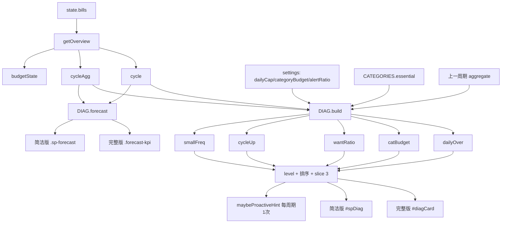

# AI记账 · 增量设计与施工图（2026-10-26）

> 架构：高见远 · 需求基线：许清楚的《钱迹 × AI记账 功能差距分析》 · 主理人已拍板 3 个待明确项（见 §8）

## 0. 范围修订（19:10 用户确认，优先级最高，与下文冲突时以本节为准）

用户确认：**只做主理人建议的 P0 三项 + 用户点名要的「说话风格」设置**。P1/P2 全部本轮不做。

**保留**
- `data.js` `CATEGORIES[].essential`（诊断卡规则③要用）
- `tone.js` 全量（17 key 文案表；未接线的 key 保留不用，无害）
- `wishlist.js` + `wishlist.test.js` + 心愿单 UI + 冷静期打通（T02、T03 全做）
- `diagnose.js` 的 `forecast` / `maxSeverity` / `build` 的**4 条规则**：`dailyOver`、`wantRatio`、`cycleUp`、`smallFreq`
- 诊断卡（完整版 + 简洁版 + 聊天提示每周期一次）
- 期末预测（完整版预算卡 KPI + 简洁版预算页）
- 说话风格设置：3 张语气卡（`#setGroupTone`），切换即时重渲染
- 设置页「单日支出上限」1 个数字输入（`dailyCap`，默认 60，规则①的旋钮）
- 打包链 16 项同步（含 `rebundle.py` `ms[11]→ms[14]`）

**砍掉（本轮不做，代码里不要留半成品）**
- ❌ `diagnose.build` 的规则② `catBudget`（分类预算上限整体不做：无 UI 则该规则永远死代码）
- ❌ `settings.categoryBudget`、`settings.worthRecapOff`
- ❌ `state.bills.worthNote` 与 `normalizeBill` 的 worthNote 改造
- ❌ §3.4-F 全部：`worthShareHtml` / `renderWorthShare` / `worthRecapCandidate` / `maybeWorthRecap` / `worthRecapHtml`，以及 `#worthShare` 卡片
- ❌ §3.4-E 中 `#setGroupDiag` 的 9 格分类预算网格（`#setBudgetGrid` / `.set-budget-grid` / `.set-budget-cell`）；`alertRatio` 用默认 0.8，**不暴露 UI**
- ❌ `#billCats` / `#spListCats` 与明细分类筛选逻辑（`billCatFilter` / `simpleListCat` / `renderBillCats` / `renderSpListCats`）、`.bill-cats` / `.bill-cat` / `.sp-cats` / `.sp-cat` 样式
- ❌ T05 中除语气卡以外的全部内容
- ❌ 故事化回顾、新手引导巡览、数据读坏自愈（本来就在 P2）

**修订后的设置字段清单**（`normalizeSettings` 只加这 5 个）
`dailyCap`(默认 60) / `alertRatio`(固定 0.8，无 UI) / `tone`(默认 gentle) / `hintCycle` / `wishReviewDate`

**修订后的任务序列**：T01（去掉规则②）→ T02 → T03 → T04′（诊断卡 4 规则 + 预测 + 单日上限输入）→ T05′（仅语气卡）。T04′ 与 T05′ 可合并执行。

---

**原范围（已作废，仅存档参考）**：P0 心愿单冷静期清单 / 消费诊断卡 / 周期末预测，P1 值不值分布+复盘 / 分类预算上限 / 明细分类筛选，S 说话风格设置（3 种语气）。

**锚点约定**：下文行号为设计时 Read 核实值（app.js 8125 / styles.css 6329 / data.js 522 / src.html 962），每条锚点均附「内容锚字符串」，行号漂移时按字符串定位。

---

## 1. 总体方案

### 1.1 新增文件（3 个，零依赖，UMD 尾照 piggy.js）

| 文件 | 职责 | 行数估 | 加载顺序 | 依赖 |
|---|---|---|---|---|
| `tone.js` | 说话风格表 + `t(key, vars)` 占位替换，不含任何存储 | ~150 | coach.js 之后 | 无 |
| `wishlist.js` | 心愿单三态清单 + 独立存储键，纯数据层（不含成品文案） | ~400 | piggy.js 之后 | 无 |
| `diagnose.js` | 消费诊断规则集 + 周期末预测，纯函数，不含成品文案 | ~230 | wishlist.js 之后、analysis.js 之前 | data.js（`CATEGORIES[].essential`）、engine.round2（本地兜底） |

设计取舍：三个新模块都不产出成品句子。`diagnose` 只出 `{code, level, amount, ...}` 事实，`wishlist` 只出数据，句子统一在 `app.js` 里用 `TONE.t('diag.'+code, vars)` 拼 —— 纯函数可单测、换语气零成本、不碰既有文案断言。

### 1.2 修改文件

| 文件 | 改动 |
|---|---|
| `data.js` | `CATEGORIES` 9 条各**追加** `essential: true/false`（不改 key/顺序/color） |
| `AI记账.src.html` | +3 个 `<script src>`；+`#wishMask` sheet；+看板 `#wishCard`/`#diagCard`/`#billCats`/`#forecastKpi`/`#worthShare`；+简洁版 `#spWishCard`/`#spListCats`/`#spForecast`/`#spDiag`；+顶栏 `#btnWishTop` 与 moreMenu 项；+设置页 2 个 group；+「我的」菜单 `#spMenuWish` |
| `styles.css` | +3 组新类（~360 行），全部用既有 CSS 变量 |
| `app.js` | 渲染/事件/归一化改造（§3.4，约 +920 行） |
| `bundle_once.py` | `LOCAL_JS` 13→16 |
| `rebundle.py` | `LOCAL_JS` 13→16；**`ms[11]` → `ms[14]`**；docstring「13 个」→「16 个」 |
| 新增 `wishlist.test.js` | 心愿单单测（照 piggy.test.js 风格） |

### 1.3 依赖顺序

```
tone.js ──┐
data.js(essential) ─→ diagnose.js ─┐
wishlist.js ───────────────────────┼─→ app.js 集成（心愿单 → 诊断卡 → 设置/筛选）
打包三处同步（src.html 标签 + 2 个 LOCAL_JS + rebundle ms[14]）
```

### 1.4 打包链硬约束

最终 `LOCAL_JS` 顺序（16 项，与 script 标签顺序必须逐字一致）：

```
data.js, nlp.js, engine.js, coach.js, tone.js, deals.js,
savings_data.js, savings.js, piggy.js, wishlist.js, diagnose.js,
analysis.js, ocr.js, intent.js, cloud-config.js, app.js
```

三个同步点（漏一个就打包失败或块错位）：
1. `AI记账.src.html`：3 个 `<script src>` 插在 `<script src="piggy.js"></script>` 之后、`<script src="analysis.js"></script>` 之前。
2. `bundle_once.py` `LOCAL_JS`（现 19-23 行）按上表 16 项。
3. `rebundle.py` `LOCAL_JS`（现 19-23 行）同 16 项，且第 38 行 `ms[11]` → `ms[14]`（cloud-config 现在是第 15 块，0 基索引 14）。

**正确顺序**：改 src.html 标签 → 改两个 py → 建 3 个 js（可先空壳）→ `python bundle_once.py` 生成 16 块单文件 → 之后才可用 rebundle 迭代。
（原因：`bundle_once.py` 有 `assert tag in html`；`rebundle.py` 有 `len(ms) != len(LOCAL_JS)` 自检，现有单文件只有 13 块，先改 LOCAL_JS 再跑 rebundle 必报错退出。）

---

## 2. 数据结构

### 2.1 新增存储键 `ai_jizhang_wishlist_v1`（WISH.KEY）

```json
{
  "v": 1,
  "items": [
    {
      "id": "w_m3k9xa_1b",
      "title": "降噪耳机",
      "amount": 599,
      "note": "宿舍太吵，想有个安静的地方",
      "status": "cooling",
      "startDate": "2026-10-26",
      "dueDate": "2026-10-28",
      "coolDays": 2,
      "extendCount": 0,
      "source": "cooling",
      "savedCounted": true,
      "billId": "",
      "createdAt": 1761465600000,
      "decidedAt": 0
    }
  ],
  "updatedAt": 1761465600000
}
```

字段约束（`normalizeItem` 逐条执行，坏条丢弃不牵连整库 —— 与 piggy 同策略）：

| 字段 | 规则 | 非法兜底 |
|---|---|---|
| `id` | 非空字符串，去重 | 生成 `w_<ts36>_<rand36>` |
| `title` | 去空白，`slice(0,40)`，空则丢弃该条 | 丢条 |
| `amount` | `Number`，`clamp(0, 9999999)`，`round2` | 0 |
| `note` | `slice(0,60)` | `''` |
| `status` | `cooling` / `bought` / `dropped` | `cooling` |
| `startDate` / `dueDate` | `/^\d{4}-\d{2}-\d{2}$/` | 今天 / 今天+coolDays |
| `coolDays` | 只允许 `1 / 2 / 3 / 7` | 2 |
| `extendCount` | `0..2` 整数 | 0 |
| `source` | `cooling` / `manual` | `manual` |
| `savedCounted` | 布尔；true 表示金额已计入 `state.savedMoney`，成交时回退 | `source==='cooling'` |
| `billId` | 字符串 | `''` |
| `createdAt` / `decidedAt` | 毫秒数 | `Date.now()` / 0 |

上限 `MAX_ITEMS = 200`：超限先丢最旧的 `bought`/`dropped`，仍超返回 `{ok:false, reason:'full'}`。
**迁移**：老账本没这个 key → `load()` 返回空库且不写盘，首次 `add()` 才落盘。存档解析失败只清空本键（`ready` 仍 true），绝不触碰 `ai_jizhang_v1`。

### 2.2 `state.settings` 新增字段（全部在 `normalizeSettings` 兜底，app.js:422-447）

```js
dailyCap:        clampNumber(s.dailyCap, 0, 99999, 60),        // 单日支出上限，0=关闭规则①
alertRatio:      clampNumber(s.alertRatio, 0.3, 1, 0.8),        // 非必需占比阈值
categoryBudget:  { /* 只保留 key ∈ DATA.CATEGORY_KEYS 且 0 < v <= 999999 的项，round2 */ },
tone:            (s.tone === 'strict' || s.tone === 'rational') ? s.tone : 'gentle',
hintCycle:       /^\d{4}-\d{2}-\d{2}$/.test(s.hintCycle) ? s.hintCycle : '',    // 诊断卡聊天提示去重（存 cycle.start）
wishReviewDate:  /^\d{4}-\d{2}-\d{2}$/.test(s.wishReviewDate) ? s.wishReviewDate : '', // 心愿单回访「同一天一次」
worthRecapOff:   s.worthRecapOff === true                       // 值不值复盘「之后不再提醒」
```

`categoryBudget` 归一化：`var cb = (s.categoryBudget && typeof s.categoryBudget==='object') ? s.categoryBudget : {};`，遍历 `DATA.CATEGORY_KEYS` 取值，**空串/null 删键**，不保留未知分类。
注意：`normalizeSettings` 是全量重建，不加进 return 对象 → 每次 `persistSettings()` 都会把新字段抹掉。

### 2.3 `state.bills` 新增字段（仅 1 个）

`normalizeBill`（app.js:385-399 return 对象）末尾追加：

```js
worthNote: (typeof b.worthNote === 'string') ? b.worthNote.slice(0, 60) : '',
```

其余字段不动，`worth` 三档 `'worth'|'mid'|'waste'` + `''` 不许改。

### 2.4 `data.js` CATEGORIES 改动（只追加字段）

```js
{ key: '餐饮', color: '#07C160', essential: true  },
{ key: '社交', color: '#FF8A3D', essential: false },
{ key: '购物', color: '#7C6CF0', essential: false },
{ key: '学习', color: '#3D9CFF', essential: true  },
{ key: '交通', color: '#2AC6C0', essential: true  },
{ key: '娱乐', color: '#EF5350', essential: false },
{ key: '居住', color: '#B0803C', essential: true  },
{ key: '医疗', color: '#E0629A', essential: true  },
{ key: '其他', color: '#9AA3AD', essential: false }
```

非必需 = 社交 / 购物 / 娱乐 / 其他。导出对象不加新键。

---

## 3. 接口与函数签名

### 3.1 `window.AJ.tone`（tone.js）

```js
TONES          // [{key:'gentle',name:'温柔学姐',desc:'先接住情绪，再给建议'},
               //  {key:'strict',name:'铁面教练',desc:'不哄你，只说问题'},
               //  {key:'rational',name:'理性分析官',desc:'只讲数据和结论'}]
DEFAULT_TONE   // 'gentle'
normalize(key) // -> 'gentle'|'strict'|'rational'；未知回落 'gentle'
t(key, vars)   // 查表顺序 TABLE[tone][key] → TABLE.gentle[key] → ''；占位 /\{(\w+)\}/g 纯字符串替换，不 eval
has(key)       // -> boolean
```

**文案归属清单（17 key，全部属于本轮新增功能）**

| key | vars | 温柔学姐(默认) | 铁面教练 | 理性分析官 |
|---|---|---|---|---|
| cool.added | title | 好，{title} 先放进心愿单，48 小时后我们再聊。 | {title} 已入清单，48 小时内不许下单。 | 已为「{title}」设置 48 小时冷静观察期。 |
| cool.due | title | {title} 的冷静期到了，还想买吗？ | {title} 冷静期结束，给个结论。 | 「{title}」观察期已结束，请做决策。 |
| cool.bought | title,amount | 想清楚就好，{amount} 已记上啦。 | 行，买了就买了，{amount} 已入账。 | 已按决策记账：{title}，金额 {amount}。 |
| cool.dropped | title,amount | 真棒！放下的 {amount} 会留在你兜里。 | 顶住了，{amount} 保住了。 | 「{title}」判定为放弃，节省 {amount}。 |
| cool.extend | days | 再给自己 {days} 天，想清楚更划算。 | 只准再延一次，{days} 天后必须决定。 | 观察期延长 {days} 天，累计延长次数已记录。 |
| cool.saved | amount | 因为冷静期，你已经省下 {amount} 了。 | 冷静期替你拦下 {amount}，继续。 | 冷静期累计节省金额：{amount}。 |
| diag.dailyOver | days,amount | 有 {days} 天单日花超了，最多的一天 {amount}。 | {days} 天超标，手太松了。 | 单日超阈值天数 {days}，峰值 {amount}。 |
| diag.catBudget | cat,amount | {cat} 这个分类有点超了，已经 {amount}。 | {cat} 又超了，{amount}，先停一停。 | {cat} 分类支出 {amount}，已越预算上限。 |
| diag.wantRatio | ratio,amount | 非必需消费占了 {ratio}，一共 {amount}。 | {ratio} 花在「想要」上，收一收。 | 非必需分类占比 {ratio}，金额 {amount}。 |
| diag.cycleUp | growth,amount | 比上个周期多花了 {growth}，这周期 {amount}。 | 涨了 {growth}，钱花快了。 | 环比上一周期上升 {growth}，当前 {amount}。 |
| diag.smallFreq | count,amount | {count} 笔小额加起来 {amount}，其实是它最贵。 | {count} 笔小钱，{amount}，全是漏。 | 小额高频 {count} 笔，合计 {amount}。 |
| diag.empty | — | 这周期没什么明显问题，保持就好。 | 没毛病，继续盯住。 | 本周期未触发任何诊断规则。 |
| forecast.over | amount | 照这个节奏，期末会超 {amount}，缓一缓。 | 会超 {amount}，现在不改就来不及。 | 期末预测超支 {amount}。 |
| forecast.safe | amount | 照现在这样，期末还能剩 {amount}。 | 还剩 {amount}，别乱花。 | 期末预测结余 {amount}。 |
| worth.recap | title | 这笔「{title}」还值吗？ | 「{title}」到底值不值，给个说法。 | 请评估「{title}」的价值。 |
| worth.thanks | — | 记下了，你对钱越来越有感觉了。 | 行，评价收到。 | 评价已保存。 |
| hint.proactive | n | 我看了下这个周期的账，有 {n} 个地方想跟你聊聊。 | 别装看不见，{n} 个问题。 | 本周期检测到 {n} 条消费异常，是否查看？ |

**不走语气表、禁止改动**：`coach.js` 全文、`app.js` 既有 `renderCoolingIntro|Question|Verdict` 标题与旧按钮字、`maybeProactiveHint` 现有那句「最近是不是外卖点得有点多」、`worthSectionHtml`、`renderAchievement`、`engelText`、抽屉说明、`data.js ALTERNATIVES`、`deals.js` / `savings*.js` 全部、简洁版 `sp-*` 既有文案。

### 3.2 `window.AJ.diagnose`（diagnose.js，纯函数，零存储）

```js
/**
 * 周期末预测（周期口径，不是自然月）
 * @param {{spent:number, passedDays:number, remainingDays:number, total:number}} o
 * @return {{projected, remainingAtEnd, overBudgetBy, level:'over'|'tight'|'safe', dailyAvg}}
 * 边界：passedDays<1→1；spent<0→0；remainingDays<0→0
 *      dailyAvg=round2(spent/passedDays)
 *      projected=round2(spent+dailyAvg*remainingDays)
 *      overBudgetBy=total>0 ? round2(max(0,projected-total)) : 0
 *      level: overBudgetBy>0→'over'；remainingAtEnd<dailyAvg*2→'tight'；否则 'safe'
 */
forecast(o)

/**
 * 消费诊断
 * @param {{bills:Array, cycle:{start,end,passedDays,remainingDays}, prevExpense:number,
 *          settings:{dailyCap,categoryBudget,alertRatio}, todayKey:string}} o
 * @return {Array<{code, level:'high'|'mid'|'low', amount, count, ratio, category, days, threshold}>}
 * 排序 high→mid→low，同级按 amount 降序；内部 slice(0,3)；expense<=0 → []
 */
build(o)

/** 最高严重度：'high'|'mid'|'low'|'' */
maxSeverity(list)
```

规则集（顺序即优先级）：

| code | 触发 | 升级 | 产出字段 |
|---|---|---|---|
| `dailyOver` | `dailyCap>0`，按 `dailyMap` 统计 `sum > dailyCap` 的天数（只算 `cycle.start..todayKey`），n≥1 出条目 | n≥3 → high | `days=n`, `amount=最大单日` |
| `catBudget` | `categoryBudget[cat]>0 && spent>budget`，取 `spent/budget` 最大的**一个**分类 | ratio>1.5 → high | `category`, `amount=spent`, `ratio` |
| `wantRatio` | 非必需分类（`essential===false`）金额 `wantAmt`，`wantAmt/expense>=alertRatio && wantAmt>100` | 固定 mid | `ratio`(百分比整数), `amount=wantAmt` |
| `cycleUp` | `prevExpense>0 && (expense-prevExpense)/prevExpense>0.3` | >0.8 → high | `ratio=增长率%`, `amount=expense` |
| `smallFreq` | `thr=max(10,min(dailyAvg*0.5,100))`，`count(amount<=thr && type!=='income')>=5` | 固定 mid | `count`, `amount=小计`, `threshold=thr` |

`amount/ratio/count` 返回前四舍五入（`round2` / `Math.round`）。

### 3.3 `window.AJ.wishlist`（wishlist.js）

```js
KEY='ai_jizhang_wishlist_v1'; VERSION=1; MAX_ITEMS=200;
COOL_DAYS_DEFAULT=2; EXTEND_MAX=2; EXTEND_DAYS=3;

isReady()                       // 存储可用（隐私模式 false）
load()                          // db；坏存档只重置自己
reset()                         // 清空本键（供「重置演示数据」调用）
add({title,amount,note,coolDays,source}) -> {ok,item,reason:'title'|'full'|'store'}
list(status)                    // 省略=全部；createdAt desc
listCooling()
get(id)                         // item|null
progress(item, todayKey) -> {remainingDays, elapsedDays, pct, overdue}
   // remainingDays=到期日-今天（正=还剩，0=今天到期，负=逾期）
   // pct=clamp(round(elapsed/coolDays*100),0,100)
dueItems(todayKey) -> [item]    // status==='cooling' && dueDate<=todayKey
decide(id,status,opts) -> {ok,item,reason:'state'|'store'}   // opts.billId
extend(id,days) -> {ok,item,reason:'max'|'state'|'store'}
stats() -> {cooling,bought,dropped,coolingAmount,droppedAmount,boughtAmount,savedAmount}
   // savedAmount = Σ(status==='dropped' && savedCounted) —— 不双计
dateKey(v) / addDays(key,n)     // 导出供测试
__store()                       // 仅单测：注入坏存档
```

`add/decide/extend` 写盘失败回滚与 `piggy.deposit` 一致（先改内存 → save 失败回退内存并返回 `reason:'store'`）。

### 3.4 `app.js` 新增/改造（锚点=内容字符串，括号为当前行号）

**A. 模块别名（app.js:22 之后，紧跟 `var SAV = ...`）**

```js
var TONE = (global.AJ && global.AJ.tone) || null;
var WISH = (global.AJ && global.AJ.wishlist) || null;
var DIAG = (global.AJ && global.AJ.diagnose) || null;
```

照 `PIGGY`（app.js:30-56）的「替身」范式各写降级 stub：`WISH.missing=true; isReady()->false; load(){}; dueItems()->[]; stats()->{全0}`；`DIAG.build()->[]; forecast()->{projected:0,...}`；`TONE.t()->''`。缺文件时入口自动隐藏、其它功能零影响。

**B. 归一化**

| 位置 | 锚点 | 改造 |
|---|---|---|
| `normalizeBill` | `worth: (b.worth === 'worth' ...` (397) | 其后加 `worthNote` 一行 |
| `normalizeSettings` | `return { profile: {` (427) | return 对象追加 §2.2 七个字段 |

**C. 冷静期打通（P0-1 关键）**

| 位置 | 锚点 | 改造 |
|---|---|---|
| `startCoolingFlow` (1068) | `cooling = { item: ...` | 对象加 `coolDays: 2, wishId: ''` |
| `renderCoolingVerdict` (1105-1126) | `data-act="cool-skip"` | 不新增 act，仍用 `cool-skip`，只把 label 改成 `先不买了，放进心愿单`（无价格分支保持原样） |
| `coolingRecord` (1155-1170) | `var bill = commitBill(draft);` | 之后追加：`if (cooling.wishId) { WISH.decide(cooling.wishId,'bought',{billId:bill.id}); if (savedCounted) { state.savedMoney -= amount; state.blockedCount=max(0,-1); saveState(); } }`，气泡走 `TONE.t('cool.bought')` |
| `coolingSkip` (1173-1188) | `state.savedMoney = ENG.round2(...)` | 保留现有计账；追加 `var r=WISH.add({title:cooling.item, amount:cooling.price, note:coolingReason(), coolDays:2, source:'cooling'})`；`cooling.wishId=r.item.id`；气泡换 `TONE.t('cool.added')` |
| 新增 `coolingReason()` | — | 由 `cooling.answers` 映射 `COACH.COOLING_STEPS` 的 label 拼一句，≤60 字，供 `note` |

**D. 心愿单 UI（新增函数）**

```
renderWishCard(ov)        看板卡（#wishCard/#wishMini）
renderWishSheet()         #wishBody：三 tab（冷静中/已买/已放弃）+ 列表 + footer 累计省下
wishSheetHtml()           tab 内容 HTML（进度条 role=progressbar）
openWishSheet()/closeWishSheet()
wishPanelClick(e)         data-act：wish-buy / wish-drop / wish-extend / wish-tab / wish-del
renderSimpleWish(ov)      简洁版首页 #spWishCard
maybeWishReview()         init 末尾 + switchView 到 chat/sai；dueItems>0 且 settings.wishReviewDate!==今天 → 推回访气泡卡，写回 wishReviewDate
reviewedWishHtml(items)   回访卡（最多 2 条，其余引导开 sheet）
wishReviewDecide(id,act)  三出口统一入口
```

**E. 诊断 / 预测 / 值不值 / 筛选 / 设置**

| 位置 | 锚点 | 改造 |
|---|---|---|
| `renderDashboard` (1652) | `renderSavingsMini(ov);` (1659) | 追加 `renderWishCard(ov);` |
| 同上 | 恩格尔 else 块结束 `}`(1714) 与 `/* ---- 分类占比 ---- */` 之间 | 插 `renderDiagCard(ov);` |
| 同上 | `renderBillList();` (1723) 之后 | 插 `renderWorthShare(ov);` |
| `renderSimpleHome` (1948) | `$('spTodayBills').innerHTML=...` (1968) | 追加 `renderSimpleWish(ov);` |
| `renderSimpleBudget` (2009) | piggyNote 块尾 `}` (2052) | 追加 `renderSimpleForecast(ov); renderSimpleDiag(ov);` |
| `renderBillList` (1852) | `var sorted = state.bills.slice()` (1854) | 前置 `var pool = billCatFilter ? state.bills.filter(catOk) : state.bills;`，末尾调 `renderBillCats()` |
| `renderSimpleList` (1972) | `var monthBills = state.bills.filter(...)` (1978) | 加 `&& simpleListCatOk(b)`，末尾调 `renderSpListCats()`（只重画列表，不动 `simpleListYM`，不碰输入框） |
| `renderSettingsPage` (2965) | `$('setCacheValue').textContent=...` (2978) | 追加 tone 单选回填、`#setDailyCap`/`#setAlertRatio` 回填、`#setBudgetGrid` 用 `DATA.CATEGORIES` 生成 9 格 |
| `bindSettingsEvents` (2982) | `$('rowSetCache')...` (3041) 之前 | 追加 `#setToneGroup` change、`#setBudgetGrid` input/change 委托、`#setDailyCap`/`#setAlertRatio` change → 全走 `persistSettings()+renderAll()` |
| `maybeProactiveHint` (7404) | `if (proactiveShown) { return; }` | 保留现有分支，在 `bs.isOver` 分支之后追加：`DIAG.build` 有 high/mid 且 `settings.hintCycle !== ov.cycle.start` → 推 `TONE.t('hint.proactive')` +「看看诊断」按钮，写回 `hintCycle` |
| `init` (8095) | `PIGGY.load();` (8098) | 其后 `if (WISH && !WISH.missing) { WISH.load(); }`；末尾 `maybeProactiveHint();` 后加 `maybeWishReview();` |
| `bindEvents` Escape (8045-8055) | `if (!$('piggyMask').hidden)` (8050) | 追加 `if (!$('wishMask').hidden) { closeWishSheet(); }` |
| `bindEvents` 弹层绑定 (8057-8076) | `$('btnClosePiggy')...` | 追加 `btnCloseWish`/`btnWishTop`/`btnWishCard`/`wishMask` 遮罩/`wishBody` 委托/`spWishCard` |
| `bindSimpleEvents` (2073) | `$('spMenuPiggy')...` (2100) | 追加 `spMenuWish`→`openWishSheet`；`spListCats` 委托写 `simpleListCat` 后 `renderSimpleList()` |
| 新变量 | 与 `simpleListYM` (1901) 同处 | `var simpleListCat='';`；与 `proactiveShown`(7368) 同处 `var billCatFilter='';` |

**F. 值不值分布（P1-1）** —— 不改 `worthStats`/`worthSectionHtml`（后者被账单分析报告 3985 行调用）

```
worthShareHtml(s)     // 横向堆叠条：3 段 flex-grow=笔数；色 --green/--amber/--line
                      // 图例：值 X 笔 占 Y% / 一般 / 不值；未评提示「还有 N 笔没评价」
renderWorthShare(ov)  // 写进 #worthShare
worthRecapCandidate() // date <= today-7 且 !worth 且 type!=='income'，取最近 1 笔
maybeWorthRecap()     // switchView 到 chat/sai 时调；settings.worthRecapOff 为真则跳过
worthRecapHtml(bill)  // 气泡卡：3 个 data-act="worth" 按钮（复用 worthBtns 的 data 协议）
                      //  + textarea 写 bill.worthNote +「以后不再提醒」
```

关键复用：气泡里三档按钮直接复用 `data-act="worth" data-bill data-val`（app.js:893-903），点击走既有 `chatList` 委托（7495 起），不新写一套。

---

## 4. 调用流程

### 4.1 冷静期 → 入清单 → 到期回访 → 成交/放弃

```mermaid
sequenceDiagram
    autonumber
    participant U as 用户
    participant A as app.js
    participant W as AJ.wishlist
    participant L as localStorage
    U->>A: 想买降噪耳机 599
    A->>A: startCoolingFlow(item,599) cooling.coolDays=2,wishId=''
    A->>U: 三步问答卡
    U->>A: coolingAnswer() x3
    A->>U: renderCoolingVerdict()
    U->>A: 点「先不买了，放进心愿单」(cool-skip)
    A->>A: coolingSkip(): savedMoney+=price, blockedCount+=1
    A->>W: add({title,amount,note,coolingReason(),coolDays:2,source:'cooling'})
    W->>L: save()
    alt 写盘失败
        W-->>A: {ok:false,reason:'store'} 回滚内存
    else 成功
        W-->>A: {ok:true,item}
        A->>A: cooling.wishId=item.id
        A->>U: 气泡「已放进心愿单，48 小时后我再来问你」
    end
    Note over U,L: 隔天打开 App
    A->>W: dueItems(todayKey)
    A->>A: settings.wishReviewDate===today ? 跳过 : 写回 today
    A->>U: 回访气泡卡（三出口）
    alt 现在还想买
        U->>A: wishReviewDecide(id,'bought')
        A->>A: commitBill({...}); savedMoney-=amount; blockedCount=max(0,-1)
        A->>W: decide(id,'bought',{billId})
    else 算了不买了
        U->>A: wishReviewDecide(id,'dropped')
        A->>W: decide(id,'dropped')  // 不动 savedMoney，避免双计
    else 再冷静几天
        U->>A: wishReviewDecide(id,'extend')
        A->>W: extend(id,3)  // extendCount<2 否则 {ok:false,reason:'max'}
    end
```

### 4.2 诊断卡 + 期末预测数据流



---

## 5. UI 契约

### 5.1 新增 CSS 类名

**完整版**（插在 `.card-engel` 规则块之后）

```
.card-wish  .wish-mini  .wish-mini-top  .wish-mini-amt  .wish-mini-meta  .wish-mini-bar(>i)  .wish-mini-note
.sheet-wish  .wish-tabs  .wish-tab(.active)  .wish-list  .wish-item  .wish-item-main
.wish-item-title  .wish-item-note  .wish-item-meta  .wish-overdue
.wish-bar(>i)  .wish-actions  .wish-btn(--primary/--ghost/--danger)
.wish-empty  .wish-sec  .wish-stat  .wish-foot-note
.card-diag  .diag-list  .diag-item(.is-high/.is-mid/.is-low)  .diag-bar
.diag-main  .diag-head  .diag-title  .diag-evidence  .diag-action  .diag-empty
.forecast-kpi  .fk-label  .fk-value(.is-over)  .fk-note
.worth-share  .worth-share-bar  .worth-share-seg(.s-worth/.s-mid/.s-waste)
.worth-share-legend  .worth-share-tip
.bill-cats  .bill-cat(.active)
.set-tone-card(.active)  .stc-main  .stc-sample  .set-budget-grid  .set-budget-cell
```

**简洁版**（只用 `--sp-*` 变量）

```
.sp-wishcard  .sp-wish-row  .sp-wish-label  .sp-wish-count  .sp-wish-bar(>i)  .sp-wish-note
.sp-forecast  .sp-forecast b(.is-over)  .sp-forecast small
.sp-diag  .sp-diag-item(.is-high/.is-mid/.is-low)  .sp-diag-head  .sp-diag-title  .sp-diag-text
.sp-cats  .sp-cat(.active)
```

**深色模式**（`[data-theme="dark"]` 块内，只做必要覆盖）

```
[data-theme="dark"] .diag-item .diag-bar.is-high   { background: var(--danger); }
[data-theme="dark"] .wish-bar          { background: var(--raise); }
[data-theme="dark"] .bill-cat.active   { background: var(--green-soft); color: var(--green-ink); }
[data-theme="dark"] .set-budget-cell input { background: var(--raise); color: var(--text); }
```

规则：**新规则禁止裸色值**（`#fff`/`rgba()` 一律不许），只用 `--green/--green-soft/--green-ink/--amber/--amber-soft/--amber-deep/--danger/--danger-soft/--danger-deep/--card/--text/--text-2/--text-3/--line/--line-2/--raise`（完整版）与 `--sp-green/--sp-green-dark/--sp-card/--sp-text/--sp-sub/--sp-line/--sp-red/--sp-radius/--sp-shadow`（简洁版）。`--danger/--amber` 在 dark 下未提亮 → 只做背景/色条，不做文字色。

### 5.2 等级表达规则

**等级只用「左色条 + 软底色」，不用文字颜色表达。**
- 色条：high `--danger` / mid `--amber` / low `--green`（4px）
- 软底：high `--danger-soft` / mid `--amber-soft` / low `--green-soft`
- 正文一律 `--text`/`--text-2`；唯一例外：forecast 超预算数字用 `--danger-deep`

### 5.3 390/360px 约束

- grid 列写 `minmax(0,1fr)`；`.diag-item { display:grid; grid-template-columns:4px minmax(0,1fr); }`
- `.wish-item-title/.diag-title/.wish-item-note` 必须 `min-width:0; overflow-wrap:anywhere; word-break:break-word;`
- `.sp-cats/.bill-cats`：`display:flex; gap:8px; overflow-x:auto; max-width:100%; padding:2px 2px 8px; scrollbar-width:none; -webkit-overflow-scrolling:touch; overscroll-behavior-x:contain;` + `::-webkit-scrollbar{display:none}` —— 整页 `scrollWidth===clientWidth`
- `.set-budget-grid { grid-template-columns: repeat(2, minmax(0,1fr)); }`，input `width:100%; min-width:0;`
- `.set-tone-card` 竖排 3 张
- 禁止 `width:100vw`、新增 `position:fixed`、长文本 `white-space:nowrap`

### 5.4 无障碍

- 进度条 `role="progressbar" aria-valuemin/max/now aria-label="冷静期进度"`
- chips 容器 `role="tablist"`，按钮 `role="tab" aria-selected`
- icon-only 按钮（`btnCloseWish`、`wish-del`）必须 `aria-label`
- 按钮最小 40×40；`:focus-visible { outline:2px solid var(--green); outline-offset:2px; }`
- 诊断卡有内容时容器 `aria-live="polite"`

---

## 6. 任务列表

### T01 基础设施 + 数据契约 + 打包链（无依赖）
- 文件：`data.js`、`tone.js`(新)、`diagnose.js`(新)、`AI记账.src.html`、`bundle_once.py`、`rebundle.py`
- 做：① CATEGORIES 加 essential ② 写 tone.js（17 key × 3 语气 + t/has/normalize）③ 写 diagnose.js（forecast/build/maxSeverity + 5 规则 + 排序截断）④ src.html 插 3 个 script 标签 ⑤ 两个 py 的 LOCAL_JS 改 16 项 + `rebundle.py` `ms[11]→ms[14]` ⑥ `python bundle_once.py`
- 判据：
  - `python bundle_once.py` 输出 16 行「内联 JS」且 `残留真实本地 <script src>(应为空): []`
  - `node -e "console.log(Object.keys(require('./tone.js')).join())"` 含 `t,has,normalize,TONES`
  - `node -e "var d=require('./diagnose.js');console.log(JSON.stringify(d.forecast({spent:1000,passedDays:10,remainingDays:10,total:1500})))"` → `projected:2000, overBudgetBy:500, level:'over'`
  - `node -e "console.log(require('./diagnose.js').build({bills:[],cycle:{start:'2026-10-01',end:'2026-10-31',passedDays:1,remainingDays:31},prevExpense:0,settings:{},todayKey:'2026-10-01'}).length)"` → `0`
  - `node intent.test.js` 仍 154 断言全过
- 预估：+400 / −3

### T02 心愿单数据层 + 单测（依赖 T01）
- 文件：`wishlist.js`(新)、`wishlist.test.js`(新)
- 做：§3.3 全部 API + §2.1 schema + piggy 级存储纪律（isReady / 坏库只重置自己 / 写盘失败回滚 / MAX_ITEMS / UMD 尾 + node 内存 store）
- 判据：`node wishlist.test.js` 全绿，至少覆盖 9 组：空 title 拒绝 / amount 上限 / 第 201 条 `reason:'full'` / `progress` 三态 / `extend` 第三次 `reason:'max'` / `decide` 二次 `reason:'state'` / `__store` 注入 `'{bad'` 后 `load()` 空库且 `isReady()` 仍 true / 无 localStorage 时 `isReady()` false / `stats().savedAmount` 只算 `dropped && savedCounted`
- 预估：+540

### T03 心愿单 UI + 冷静期打通（依赖 T02）
- 文件：`app.js`、`styles.css`、`AI记账.src.html`
- 做：§3.4-C/D 全部；src.html 加 `#wishMask`（`#piggyMask` 结束 `</div>` 与 `<div class="toast-root"` 之间）、看板 `#wishCard`（`#savingsCard` 结束与「分类占比」卡之间）、简洁版 `#spWishCard`（`#spQuick` 之后）、顶栏 `#btnWishTop`（`#btnPiggyTop` 之后）+ moreMenu `data-act="wish"`、我的菜单 `#spMenuWish`
- 判据：① 冷静期走完点「先不买了，放进心愿单」→ `localStorage.ai_jizhang_wishlist_v1` 出现条目 + 气泡 + 看板/首页卡各 1 条 cooling；② 顶栏/看板卡/首页卡/我的 四处可开 sheet，Esc 与遮罩可关；③ 手改 `dueDate` 为昨天 → 重开出现回访卡，三出口各自生效，`extend` 两次后按钮 disabled；④ 成交后 `state.bills` +1 且 `savedMoney` 精确回退；⑤ 390/360 无横向溢出
- 预估：app.js +260 / styles.css +150 / src.html +45

### T04 诊断卡 + 期末预测 + 值不值分布（依赖 T01）
- 文件：`app.js`、`styles.css`、`AI记账.src.html`
- 做：§3.4-E 的 renderDiagCard/renderSimpleDiag/renderSimpleForecast/forecast 接线 + §3.4-F 的 worthShareHtml/renderWorthShare/worthRecapCandidate/maybeWorthRecap/worthRecapHtml；src.html 加 `#diagCard`（恩格尔卡之后）、预算卡内 `#forecastKpi`（`.mini-stats` 之后）、L4 段 `#worthShare` 卡（`#billList` 卡之后）、简洁版 `#spForecast`/`#spDiag`（`.sp-stats3` 之后、「分类占比」之前）
- 判据：① 4 组数据分别命中规则②③④① → high 优先、最多 3 条、色条软底正确；② 空账本显示 `TONE.t('diag.empty')`；③ `spent>total` 时 `.fk-value.is-over` + `--danger-deep`；④ 连续进 2 次聊天只提示 1 次，手清 `settings.hintCycle` 后可再提示；⑤ 值不值 3 段宽度和 100%±0.5，`worthSectionHtml`（账单分析）输出与改动前逐字节一致
- 预估：app.js +230 / styles.css +120 / src.html +30

### T05 设置项（分类预算 + 语气）+ 明细分类筛选 + 全量回归（依赖 T01/T02/T03）
- 文件：`app.js`、`styles.css`、`AI记账.src.html`
- 做：§2.2 字段接线 UI：`#setGroupTone`（卡片单选，插在 `#setGroupGeneral` 的 `</section>` 与 `<!-- 数据与隐私 -->` 之间）与 `#setGroupDiag`（`#setDailyCap`/`#setAlertRatio`/`#setBudgetGrid` 9 格动态生成）；`bindSettingsEvents` 三处监听 → `persistSettings()+renderAll()`；简洁版 `#spListCats`（`.sp-month-sum` 之后）+ 完整版 `#billCats`（`#billList` 之前）
- 判据：① 3 张语气卡，切换后诊断卡文案立即变、刷新保持；② 「餐饮=300」保存后花到 480 → high；清空输入 → 不再出条目；③ 明细点「餐饮」只显示餐饮，切月份后筛选保持、月份标签正确、滚动不跳；④ `node intent.test.js`/`piggy.test.js`/`_test_savings.js`/`_test_savings_ui.js` 全绿（`_test_coach.js` 需 jsdom，无则记「未跑」不记失败）；⑤ 390/360 无横向溢出
- 预估：app.js +170 / styles.css +90 / src.html +70

依赖图：T01 → T02 → T03；T01 → T04；T02/T03 → T05。

---

## 7. 红线（不许动）

1. `CATEGORIES` 的 9 个 key、顺序、color 一律不动，只准**追加** `essential`。
2. `worth` 三档 `'worth'|'mid'|'waste'` + `''` 固定，不升 5 档；`setBillWorth` 的「再点同项取消」语义不改。
3. `DATA.STORAGE_KEY='ai_jizhang_v1'` 与 `state` 顶层结构（bills/budget/goals/savedMoney/blockedCount/uiMode/settings）不增删字段。心愿单走独立键，诊断走纯函数。
4. `intent.js` 一个字不改（154 断言）。新增聊天提示只能走 `addAIMessage`，不得注册进意图分发表。
5. 既有测试断言不得修改：`intent.test.js`、`piggy.test.js`、`_test_savings.js`、`_test_savings_ui.js`、`_test_coach.js`。必须改 → 停下来上报。
6. `FULL_VIEWS`/`SIMPLE_VIEWS` 与 `#tabbar`/`#tabbarSimple` tab 数量不动，心愿单必须是 sheet。
7. 打包三处同一提交内同步（src.html 标签 / 两个 LOCAL_JS / `rebundle.py` 的 `ms[14]`）。
8. 既有文案零改动（见 §3.1），`coach.js` 整文件不改。
9. 零外部依赖 / 不用 ES Module / 不用 `import`。
10. 新 CSS 规则禁止裸色值。

---

## 8. 待明确事项（主理人已拍板）

1. **到期回访时机**：打开 App（`init` 末尾）+ 每次切到 `chat`/`sai` 各查一次，同一天只提醒一次（`settings.wishReviewDate`）；不接系统级 Notification。→ **按此实现**。
2. **`savedMoney` 口径**：入清单即计入省下的钱（沿用 `coolingSkip` 现有行为），成交时按 `savedCounted` 精确回退。→ **按此实现**。
3. **简洁版深色下 `--sp-card` 仍为白色**：既有现象，本轮新样式全部用 `--sp-*`，**不修全局深色调色板**。→ **本轮不动**。


---

## 9. 验证记录（2026-10-26 19:50~20:20）

**验证方式**：QA（严过关）在 19:44 因账号频率限制（429，22:45 重置）中断，未完成独立验证；主理人接手，直接运行 QA 已写好的测试脚本取证。

| 测试 | 结果 |
|---|---|
| `node qa_v12_unit.js`（QA 写的单元测试） | 通过 211 / 共 211 |
| `node qa_v12_e2e.js`（真实 Chrome，CDP 驱动） | 通过 198 / 共 198，console error 0，截图 27 张 |
| `node intent.test.js` | 172 / 172 |
| `node wishlist.test.js` | 97 / 97 |
| `node piggy.test.js`（重建版） | 117 / 117 |
| `_test_savings.js` / `_test_savings_ui.js` / `_test_coach.js` | 文件在本工作区不存在（README 有引用），未跑 |

**E2E 覆盖**：首开/老账本/坏存档兼容性、心愿单冷静期三步与到期回访三出口、诊断卡 4 条规则逐条命中与排序、期末预测双 UI 与手算校验、说话风格切换与持久化、双 UI 四入口、390/360 无横向溢出、深色模式对比度 ≥4.5:1、既有功能回归（恩格尔/分类占比/趋势/理财专家/省钱助手/存钱罐/目标池/简洁版六屏）、`file://` 协议冒烟。

**本轮修掉的 2 个真实缺陷**（E2E 取证后由主理人修复）
1. **`diagInput` 传 Date 给 `ENG.aggregate`** → 区间过滤失效、上一周期支出被算成全账本（1200 而非 200），导致「环比涨太快」规则永远命中不了。修法：`app.js` 里 `ENG.formatDate(ENG.addDays(...))` 转成日期串，并在 `engine.js` 的 `aggregate` 入口加 Date→串归一化做兜底。
2. **简洁版超预算数字颜色偏浅**（`--sp-red` #EF5350，3.49:1）→ 改为 `--danger-deep`（#B91C1C，≥6:1）。

**顺带修掉的外部改动引入的语法错误**：另一进程把 `inlineIcon` 函数连同注释插到了 `data.js` 导出对象 `};` 之后，且注释缺 `/**`，导致整段 JS `SyntaxError: Unexpected token '*'`，页面 `DATA` 未定义全崩。已把该函数搬到 `var DATA = {` 之前并补全注释开头。

**已知遗留（不修，已记录）**
1. 简洁版新增卡片的小字沿用既有 `--sp-sub`（`#8A939C`，白底 3.12:1），未达 4.5:1；QA 记为观察项，因该变量被简洁版全局使用，改动面大，留待下一轮统一处理。
2. `piggy.js` 的 `ready` 标记为一次性粘滞：隐私模式/配额异常触发 false 后不会复位（需重载页面），此时数据实际仍可写入，但 UI 持续显示只读。
3. 本轮产物中混入了非本团队的并行改动（快速记账弹窗的「这笔属于」三选、「记收入 →」出口、分类图标 `ink` 字段与 `spCatTileStyle`），已随打包进入 `AI记账.html`，需确认是否保留。
